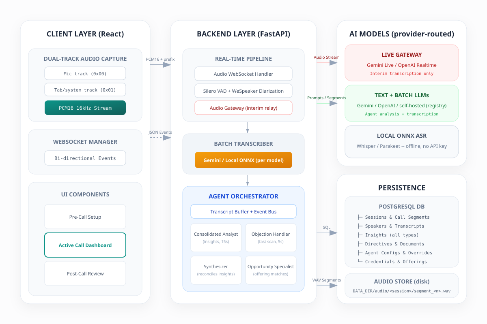

# DebateAI-Handbuch

Diese Datei enthält die laufenden technischen Verträge für Einrichtung, Architektur, Konfiguration, API, Deployment, Release und Workspace. Produktziel und Prioritäten stehen in [VISION.md](VISION.md). Nicht belegte oder noch nicht abgenommene Punkte stehen in [OFFENE_PUNKTE.md](OFFENE_PUNKTE.md). Datiertes Wissen und abgelöste Arbeitsstände stehen in [HISTORIE.md](HISTORIE.md).

## Schnellzugriff

- [Quickstart und lokale Entwicklung](#quickstart-und-lokale-entwicklung)
- [Architektur und Datenfluss](#architektur-und-datenfluss)
- [WebSocket-Protokoll](#websocket-protokoll)
- [REST-API](#rest-api)
- [Konfiguration und Datenschutz](#konfiguration-und-datenschutz)
- [Deployment und Betrieb](#deployment-und-betrieb)
- [Release, Signierung und Wiederherstellung](#release-signierung-und-wiederherstellung)
- [Generierter Workspace und Recovery](#generierter-workspace-und-recovery)
- [Repository- und GitHub-Vertrag](#repository-und-github-vertrag)
- [Designsystem](#designsystem)
- [Statische Analyse und Triage](#statische-analyse-und-triage)


## Quickstart und lokale Entwicklung

Konsolidiert aus `HANDBUCH.md`.

### Desktop app (easiest)

Prefer the shortest path? Download the latest desktop build from the
[public DebateAI download portal](/downloads/). The deployment-specific
HTTPS update endpoint configured by the operator serves the same verified assets.
Downloads are open to everyone when the configured endpoint is public. The
application never assumes a vendor portal; see the release notes shipped with
your deployment for its current asset inventory.

- **Windows** -- `DebateAI-windows-x64.zip`; unzip and run `DebateAI.exe`.
- **macOS** (Apple Silicon) -- `DebateAI-macos-arm64.zip`; unzip and open `DebateAI.app`.
- **Linux** (x64) -- `DebateAI-linux-x64.tar.gz`; a portable bundle (not a
  package-manager installer): `tar -xzf` it and run `DebateAI/DebateAI`.

The complete German Windows install, provider-login, Ollama, audio, build,
update and signing procedure is in the [release and recovery section](HANDBUCH.md#release-signierung-und-wiederherstellung).

The app runs from your system tray / menu bar and stores data per-user --
`%LOCALAPPDATA%\DebateAI` on Windows,
`~/Library/Application Support/DebateAI` on macOS,
`~/.local/share/debateai` on Linux -- no Docker needed. Set a Gemini API key in Admin -> Connections on first run ([API credentials](HANDBUCH.md#api-credentials) shows how to create one in about two minutes). For the full self-hosted stack, use Docker Compose below.

#### First-run onboarding in the desktop GUI

When no debate exists yet, the center screen shows the three-step onboarding
checklist. **Modelle prüfen → Einstellungen** opens **Admin → Verbindungen**
with the **Ersteinrichtung** card. Save or test the desired provider there,
then choose the available models under **Assistenten** and **Transkription &
Audio**. The card shows **Zum ersten Gespräch** once the selected
transcription and agent models are runnable. The same connection and model
pages remain available under **Admin** after the first conversation.

#### Keeping the desktop app up to date

From v0.4.0 the desktop app updates itself in place. "Check for updates" in
the tray menu (or Admin -> About) checks for a newer version; when one is
available, download it from the update card. The app verifies the signed descriptor and
asset before installation. Every update is verified
against the Ed25519 signing keys shipped with the app before it is applied,
and installation is blocked until any active call, recording, or
post-processing has finished. The app then restarts into the new version,
keeping a backup and rolling back to the previous version automatically if
the new one fails to start.

### Prerequisites

- Docker with Docker Compose (the primary way to run the stack), or
  Node 24.x / Python 3.12 / PostgreSQL 16 for local development
- A Google Gemini API key for the default cloud transcription and analysis
  models. It is not required for the local German Debate Copilot setup below.
  An OpenAI key is optional and only needed for OpenAI-routed agents.
  New to either provider? [API credentials](HANDBUCH.md#api-credentials) is a two-minute
  walkthrough.
- `ffmpeg` on `PATH` when running outside Docker, if you want compressed
  audio imports (MP3, M4A) or the browser-recorded voice profile and mic
  benchmark clips (WebM). Desktop releases after v0.3.1 bundle ffmpeg on
  Windows and Linux; the macOS desktop bundle still needs a system install

API keys can be supplied two ways:

1. In the app: Admin -> Connections stores keys encrypted at rest
   (see [Configuration](HANDBUCH.md)) -- recommended.
2. Environment fallback: copy `.env.example` to `.env` and set
   `GEMINI_API_KEY` (and optionally `OPENAI_API_KEY`).

### Local German Debate Copilot on Windows (no API key)

On Windows 11 with Docker Desktop, open PowerShell in the clone's `app` directory and run:

```powershell
powershell -ExecutionPolicy Bypass -File .\scripts\setup_debate_assistant.ps1
```

The command is safe to run again. It installs Ollama through Winget when
needed, pulls `qwen3:4b`, starts the Compose stack, registers the local Ollama
endpoint, points the debate and background agents at it, selects German
Parakeet v3 for final and interim transcription, uses the existing NVIDIA
Compose override when `nvidia-smi` is available, and enables Privacy First.
Nothing in this default path needs a paid API or sends meeting content to a
cloud model.

Useful switches:

```powershell
# Show every action without changing the machine.
.\scripts\setup_debate_assistant.ps1 -DryRun

# Keep local inference, but allow optional keyless fact research.
.\scripts\setup_debate_assistant.ps1 -Research

# Reconfigure an existing Ollama installation without installing/pulling.
.\scripts\setup_debate_assistant.ps1 -SkipInstall -SkipModelPull
```

`-Research` is an explicit egress choice: only a short factual query produced
by the local model can be sent to configured ChatGPT Web/Gemini AI research lanes.
Audio and the transcript remain local. Without that switch, Privacy First
blocks this research path as well.

DebateAI data lives in the Docker volumes `pgdata` and `backend_data`.
Ollama stores its model files in the current Windows user's Ollama data
directory (normally `%USERPROFILE%\.ollama`). `docker compose down` keeps the
volumes; `docker compose down -v` permanently removes the DebateAI database
and audio data.

For a Discord or WhatsApp Web call, use a Chromium browser and include the
call tab or system audio when the browser's sharing dialog asks what to share.
For the installed Discord or WhatsApp desktop app, choose the system-audio
source in DebateAI; Windows must allow loopback/system capture. Keep the
microphone source enabled separately so local and remote speech remain on two
tracks. If the audio meter for either track stays flat, stop the call, select
that source again, and verify the Windows privacy permission for the browser.

Recovery checks:

```powershell
ollama list
docker info
docker compose -f docker-compose.yml -f docker-compose.debate.yml ps
docker compose -f docker-compose.yml -f docker-compose.debate.yml logs backend
```

If Ollama is not responding, start it from the Start menu or run
`ollama serve`; then rerun the setup command. If Docker is stopped, start
Docker Desktop and rerun the same command. Existing endpoint and agent rows are
updated in place rather than duplicated.

### Docker Compose (primary)

```bash
cp .env.example .env   # then edit values
docker compose up --build
```

- Frontend: http://localhost:3000
- Backend API: http://localhost:8001 (interactive OpenAPI docs at
  http://localhost:8001/docs)
- PostgreSQL 16 on host port 5432

The frontend nginx container proxies `/api` and `/ws` traffic from port 3000
to the backend, so the browser only ever talks to port 3000.

Stop the stack:

```bash
docker compose down        # keep data
docker compose down -v     # also delete the database and audio volumes
```

#### GPU startup (Sortformer diarization)

Windows desktop releases already include the pinned Torch, CUDA, and NeMo
runtime. Open **Admin → Transkription & Audio**, run the Sortformer benchmark,
and select Enhanced only after the local benchmark passes. Docker uses the
same model contract inside its backend image.

Use the GPU override when running on a host with NVIDIA GPU support. It
builds the backend with GPU ONNX Runtime and reserves the GPU for the
backend container:

```bash
docker compose -f docker-compose.yml -f docker-compose.gpu.yml up -d --build
```

See [Deployment](HANDBUCH.md) for build arguments and GPU validation.

On Windows with an AMD GPU (e.g. Radeon RX 9070 XT), Docker cannot use the
GPU; run the backend natively instead with
`.\backend\scripts\setup_windows_gpu.ps1` -- see
[AMD GPU on Windows](HANDBUCH.md#amd-gpu-on-windows-native-backend).

### Local development

Frontend:

```bash
cd frontend
npm install
npm run dev
```

The Vite dev server proxies `/api` and `/ws` to the backend (see
`frontend/vite.config.ts`).

Backend:

```bash
cd backend
pip install -r requirements.txt
python scripts/download_models.py   # fetches the VAD and speaker-embedding ONNX models
BACKEND_WORKERS=1 uvicorn app.main:app --host 0.0.0.0 --port 8000 --workers 1 --reload
```

For local backend runs, set `DATABASE_URL` if your PostgreSQL host differs
from the default in `backend/app/config.py`.

### Database migrations

```bash
cd backend
alembic upgrade head
alembic downgrade -1
```

Note that the app also runs `Base.metadata.create_all()` and a
column-patching step on startup (`backend/app/main.py`), so a fresh database
works without running Alembic manually. Migrations matter for tracked schema
history and downgrades.

### Tests and checks

Backend tests are stdlib `unittest` files:

```bash
cd backend
python -m unittest discover -s tests
```

Frontend behavior check is the typecheck build:

```bash
cd frontend
npm run build
```

## Architektur und Datenfluss

Konsolidiert aus `HANDBUCH.md`.

DebateAI is a React SPA, a FastAPI backend, and PostgreSQL -- deployed
either as the Docker Compose stack or as the desktop bundle, a PyInstaller
launcher with an embedded per-user PostgreSQL (see
[Quickstart](HANDBUCH.md)) -- plus external AI providers (Google Gemini,
OpenAI) and local ONNX models for voice activity detection, speaker
embeddings, and optional local transcription and live captions.

Diarization always runs on your hardware, and transcription and live
captions can too (the local ONNX entries in `MODEL_REGISTRY` cover batch
transcription plus the `local-parakeet-live` live captioner), but the
analysis agents have no local ONNX path:
`backend/app/services/llm.py` routes every text call
to Google, OpenAI, or any OpenAI-compatible endpoint you point them at
(Ollama, LM Studio, vLLM). Pairing a local endpoint with local ONNX
transcription makes a deployment local end to end, with no cloud key
anywhere. The Privacy First toggle enforces exactly that boundary: it judges a
model by where it runs, so agents pointed at an endpoint on your machine or
LAN keep working while anything that would send data off your network is
refused. See
[Privacy First mode](HANDBUCH.md#privacy-first-local-only-mode) for the
admission rule and what the mode covers.



### The live call path

1. **Capture** -- `frontend/src/hooks/useAudioCapture.ts` gets microphone
   audio via `getUserMedia` (and optionally tab/system audio via screen
   capture), converts it to PCM16 16 kHz mono chunks, and sends binary
   WebSocket frames with a 1-byte track prefix (`0x00` mic, `0x01` system).
2. **Ingest** -- `backend/app/ws/audio_handler.py` accepts
   `/ws/{session_id}`, opens a call segment, and fans the audio out to two
   paths: the interim audio gateway and the diarization pipeline. Mixed
   mic+system audio is also appended to a per-segment WAV recording.
3. **Diarize** -- `backend/app/services/speaker_diarizer.py` runs Silero VAD
   to find speech, then WeSpeaker ResNet152 speaker embeddings to assign an auto
   speaker ID (`auto_1`, `auto_2`, ...) to each segment. Auto IDs are mapped
   to database `Speaker` rows, creating "Participant N" rows when a new voice
   appears. In split-track calls, mic segments bind to the sole configured local
   user while system-audio segments retain normal remote diarization.
4. **Transcribe** -- `backend/app/services/batch_transcriber.py` wraps each
   diarized segment as WAV and transcribes it (Gemini Flash by default, or a
   local ONNX model -- see [live call path](HANDBUCH.md#the-live-call-path)). Low-energy
   segments, known phantom phrases, and single-word outputs are filtered.
5. **Persist and publish** -- transcript entries are saved to PostgreSQL and
   pushed to the browser as `transcript` WebSocket messages.
6. **Analyze** -- `backend/app/services/agents/orchestrator.py` feeds final
   transcript text into a shared in-memory buffer that the text agents read
   on their own schedules. Insights come back to the browser as `question`,
   `insight_updated`, `insight_elevated`, and `question_answered` messages.
   See [agent orchestration](HANDBUCH.md#backend-key-files).

### The interim audio gateway

In parallel with the batch path, `backend/app/services/gemini_live.py` opens
a Gemini Live session as a silent listener (or
`backend/app/services/openai_realtime.py` when the audio gateway agent is
configured with an OpenAI model, or
`backend/app/services/local_live_captioner.py` -- an on-device Parakeet ONNX
captioner, no cloud -- when it is set to `local-parakeet-live`). The gateway
relays streaming interim transcription to the frontend as
`interim_transcript` messages, giving users live feedback seconds before the
diarized, speaker-attributed transcript lands.

The gateway is an audio relay only -- all analysis runs over the saved
transcript text, never over raw audio.

### Frontend structure

Main state lives in `frontend/src/App.tsx`, which switches between three
views:

- **PreCallView** -- session setup: speakers, directives, document upload,
  transcript/audio import, per-session agent selection
- **ActiveCallView** -- live call controls, transcript and interim transcript
  display, insight list, audio level indicator, mid-call directive bar
- **PostCallView** -- review tabs for Briefing (the default), Insights,
  Transcript, Chat, Speakers, Documents, Directives, and Tokens; supports
  resume, export, delete, and speaker rename

Admin surfaces (routed through `ManagementView`): `AdminPanel` with tabs
Agents, Transcription & Audio, Connections (provider keys and self-hosted
endpoints), and About (version and release notes), plus `OfferingsManager`
and `KnowledgeManager` for the offering catalog and knowledge sources.

Key hooks:

| Hook | Role |
| --- | --- |
| `useSession` | Loads session metadata, directives, documents, questions, call segments, speakers |
| `useWebSocket` | Manages `/ws/{session_id}` JSON and binary traffic |
| `useAudioCapture` | Mic/system capture, audio level, PCM16 conversion |

The frontend stores all insight item types in the `Question` shape for
historical reasons -- check `frontend/src/types/index.ts` before renaming
fields.

### Backend key files

| Area | File |
| --- | --- |
| FastAPI app, router registration, startup schema patching | `backend/app/main.py` |
| WebSocket live-call layer (entry point; the layer is five files: handler plus `audio_messages.py`, `audio_pipeline.py`, `audio_runtime.py`, `audio_persistence.py`) | `backend/app/ws/audio_handler.py` |
| SQLAlchemy models | `backend/app/models.py` |
| Pydantic schemas | `backend/app/schemas.py` |
| Settings and model registry | `backend/app/config.py` |
| Diarization | `backend/app/services/speaker_diarizer.py` |
| Batch transcription | `backend/app/services/batch_transcriber.py` |
| Transcriber routing (local vs Gemini) | `backend/app/services/local_transcriber.py` |
| Gemini Live gateway | `backend/app/services/gemini_live.py` |
| OpenAI Realtime gateway | `backend/app/services/openai_realtime.py` |
| On-device live captioner | `backend/app/services/local_live_captioner.py` |
| Provider-routed text LLM calls | `backend/app/services/llm.py` |
| Self-hosted endpoint storage and model projection | `backend/app/services/custom_endpoints.py` |
| Privacy First admission | `backend/app/services/privacy.py` |
| Local model fit test | `backend/app/services/local_fit.py` |
| Call-start capacity admission | `backend/app/services/capacity_admission.py` |
| Desktop update service | `backend/app/services/update_service.py` |
| Token usage persistence and aggregation | `backend/app/services/token_usage.py` |
| Post-call briefing synthesis | `backend/app/services/briefing_synthesis.py` |
| Agent orchestrator | `backend/app/services/agents/orchestrator.py` |
| Per-segment call audio recording | `backend/app/services/audio_store.py` |

### Persistence

PostgreSQL stores sessions and session groups, call segments (with paths to
recorded audio), speakers, transcript entries, insights (the `questions`
table holds every item type), directives, documents, agent configurations
and per-session overrides, offerings and knowledge sources, and encrypted
provider credentials. Recorded audio and downloaded model weights live on
disk under `DATA_DIR` (a Docker volume in Compose).

## WebSocket-Protokoll

Konsolidiert aus `HANDBUCH.md`.

Endpoint: `ws://<host>/ws/{session_id}`
(handler `backend/app/ws/audio_handler.py`, which delegates client JSON
messages to `backend/app/ws/audio_messages.py` and binary audio frame
decoding to `backend/app/ws/audio_runtime.py`; the frontend client is
`frontend/src/hooks/useWebSocket.ts`).

Connecting starts a call: the backend opens a new call segment, marks the
session active, starts the agent orchestrator, and begins accepting audio.
Reconnecting to a completed session resumes it and inserts a
`--- Session Resumed (Call N) ---` marker in the transcript.

For an automatic reconnect the frontend includes `after_sequence` (the last
session event it has applied), `after_epoch` (the server generation that
issued that sequence), and the stable logical `capture_id`. A new server
generation never reuses the old epoch: if `after_epoch` is stale, the backend
returns a full current snapshot instead of letting an old, larger cursor hide
new events. An explicit new capture receives a new `capture_id`.

### Client to server

#### Binary frames (audio)

PCM16, 16 kHz, mono, with a 1-byte track prefix:

```
byte 0:    track id (0x00 = microphone, 0x01 = system/tab audio)
bytes 1..: PCM16 little-endian samples
```

PCM16 payloads are even-length, so the backend uses frame parity to detect
the prefix: odd-length frames are prefixed, even-length frames are treated
as legacy microphone audio without a prefix.

#### JSON messages

```json
{"type": "track_state", "track": 1, "active": false}
```

Reports whether system/tab audio is currently active. The backend snapshots
this state when each microphone segment is queued so later transcription does
not change its speaker-routing policy.

```json
{"type": "stop", "drain": "full"}
```

Ends the call. The backend flushes the diarizer, drains in-flight
transcription and agent work, closes the audio recording, marks the session
completed, and reports post-processing progress via `status` messages.

The optional `drain` field selects how much post-call analysis runs:

- `"full"` (default, and the behavior of a bare `{"type": "stop"}`): final
  insight pass, insight reconciliation, opportunity matching, and briefing
  synthesis.
- `"skip_analysis"`: final insight pass and insight reconciliation only;
  briefing synthesis and opportunity matching are skipped. The briefing can
  be generated later with `POST /api/sessions/{id}/synthesis/refresh`.

Unknown values fall back to `"full"`. If the socket disconnects or errors
without a stop message, the backend runs a minimal drain instead: it flushes
and transcribes buffered audio, closes the recording, and completes the
session with no analysis agent calls. Per-agent enablement still applies
within every mode.

```json
{"type": "directive", "text": "Focus on pricing objections"}
```

Adds a mid-call directive: persisted to the database and injected into agent
context immediately.

### Server to client

All server messages are JSON with a `type` and a `data` payload.

#### `status`

Connection and pipeline state. Sent for connection lifecycle
(`connecting`, `active`, `error`), audio flow heartbeats
(`audio_received` roughly every 5 seconds, `audio_segment` when a diarized
segment is queued, `transcript_saved` after persistence), and staged
post-processing progress after stop (`post_processing` with `stage`,
`current_step`, `total_steps`, `progress`, then a final `completed`). The
first post-processing status also carries `steps`, the ordered stage ids for
the selected drain mode, so the client can render the correct pipeline.

The late post-processing statuses and the final `completed` status carry a
`details` object summarizing the final analysis pass: `insights_saved` (new
insights created by the final insight pass), `synthesizer_ops` (updates
applied to already-saved insights), `opportunity_ops` (offering matches
applied), `transcription` (queue stats), and `session_insight_total` (the
session's total insight count at drain completion, so clients can anchor the
pass counters against the lifetime total).

```json
{"type": "status", "data": {"state": "active", "message": "Listening..."}}
```

#### `session_snapshot`

Every connection receives a replay snapshot before live events. Its `data`
contains `server_epoch`, `through_sequence`, `full`, and ordered `events`.
`full` is true when the cursor is missing, outside the retained journal, or
belongs to another server epoch; otherwise only events after
`after_sequence` are returned. The client must reset its local cursor/history
when `server_epoch` changes before applying the snapshot.

```json
{
  "type": "session_snapshot",
  "data": {
    "session_id": "9b1c...",
    "server_epoch": "4a1f...",
    "through_sequence": 42,
    "full": false,
    "events": []
  }
}
```

#### `agent_activity`

A coalesced snapshot of live agent status, emitted by the orchestrator's
activity registry (`backend/app/services/agents/activity.py`) at most every
~2 seconds, immediately on errors, blocks, and degradation changes. `data`
carries `session_id`, `at`, an `agents` array (per agent: `slug`, `state`,
`blocked_reason` / `remedy`, last run timing, `next_due_at`, `last_outcome`,
`last_error`, and cumulative `counts` of runs, insights, deduped items, and
errors), and a `call` health block: `privacy_first`, `degraded`,
`degraded_reasons`, plus `gateway` (`ok` / `reconnecting` / `off` with
detail), `transcription` (job and failure stats), and `diarization`
(queued and the legacy `shed` counter). The counter remains zero for already
accepted PCM under the no-drop contract; an overload status carries the
rejected byte count explicitly.

#### `interim_transcript`

Low-latency unattributed text from the audio gateway (Gemini Live, OpenAI
Realtime, or the on-device local captioner selected as `local-parakeet-live`,
`backend/app/services/local_live_captioner.py`). Display-only; superseded by
`transcript` messages.

```json
{"type": "interim_transcript", "data": {"text": "so in terms of timeline we were hoping"}}
```

#### `transcript`

A final, speaker-attributed transcript entry, already persisted.

```json
{
  "type": "transcript",
  "data": {
    "id": "6a2f...",
    "session_id": "9b1c...",
    "text": "We were hoping to launch before the end of the quarter.",
    "timestamp": "2026-07-04T17:03:21.512000+00:00",
    "sequence": 42,
    "speaker_id": "d41d..."
  }
}
```

#### `question`

A new insight of any item type -- the field name is historical. `data`
carries the persisted insight including `item_type` (`question`,
`observation`, `opportunity`, `objection`, `action_item`), the content
fields, and `agent_source`. The frontend stores all of these in its
`Question` shape (`frontend/src/types/index.ts`).

#### `question_answered`

The synthesizer detected that an open question was answered in conversation.
`data` identifies the question and the answer evidence.

#### `insight_updated`

The synthesizer revised an existing insight (content enrichment,
consolidation with a near-duplicate, or an opportunity gaining offering
matches). `data` is the updated insight.

#### `insight_elevated`

The synthesizer elevated an item to a different type (for example an
observation reclassified as an opportunity). `data` is the updated insight.

#### `synthesis_updated`

The session synthesis was regenerated: by the strategic signals agent during
the call (this is how live Strategic Signals card updates reach the browser)
or by briefing synthesis at call end
(`_send_synthesis_update` in `backend/app/services/agents/orchestrator.py`).
`data` is the full persisted synthesis, the same shape
`GET /api/sessions/{id}/synthesis` returns (`SessionSynthesis` in
`frontend/src/types/index.ts`), with one deliberate omission: kept signals
arrive as a `signal_history_count` only, never as rows.

The rows are not needed there because every signal is also an ordinary insight.
The strategic-signals agent files each one as a `Question` row and those arrive
over this same socket as `question` and `insight_updated` messages like any
other insight, so the live call view reads them from the insight list rather
than from the synthesis payload. `GET /api/sessions/{id}/synthesis` still
returns the raw history under `include_history=true`, which is what the
post-call briefing's History panel uses.

### Ordering and delivery notes

- `transcript` messages are emitted in original audio order even though
  transcription is concurrent (`OrderedTranscriptionQueue`).
- `interim_transcript` text can arrive before, after, or interleaved with
  the `transcript` entries covering the same speech; treat it as ephemeral.
- If the audio gateway connection drops, the backend reconnects it
  transparently and emits `status` state changes; buffered diarized audio is
  flushed into the transcription queue first, so no attributed transcript is
  lost.

## REST-API

Konsolidiert aus `HANDBUCH.md`.

All routes are served by FastAPI under `/api` (`backend/app/main.py`
registers one router per resource from `backend/app/routers/`). Interactive
OpenAPI documentation with request/response schemas is available from a
running backend at `http://localhost:8001/docs`; the Pydantic models behind
every payload are in `backend/app/schemas.py`.

In Docker Compose the frontend nginx proxies `/api` from port 3000, so the
same paths work against `http://localhost:3000`.

### Health

| Method | Path | Purpose |
| --- | --- | --- |
| GET | `/api/health` | Liveness check |

### App metadata (`routers/meta.py`)

| Method | Path | Purpose |
| --- | --- | --- |
| GET | `/api/meta` | Current application version (`{"version": "X.Y.Z"}`) |
| GET | `/api/meta/release-notes` | In-app release notes, newest first (`version`, `date`, `title`, markdown `body`) |

Both are backed by `backend/app/release_notes.py`, the version's single
source of truth, which is updated as part of every release.

### Sessions (`routers/sessions.py`)

| Method | Path | Purpose |
| --- | --- | --- |
| POST | `/api/sessions` | Create a session |
| GET | `/api/sessions` | List sessions |
| GET | `/api/sessions/{id}` | Get one session |
| PATCH | `/api/sessions/{id}` | Update name, notes, meeting type/context, group, state |
| DELETE | `/api/sessions/{id}` | Delete a session and its children |
| GET | `/api/sessions/{id}/segments` | List call segments |
| GET | `/api/sessions/{id}/segments/{n}/audio` | Download a segment's recorded WAV |
| GET | `/api/sessions/{id}/token-usage` | Usage totals with per-source and per-model breakdowns |
| POST | `/api/sessions/{id}/enhance-insights` | Re-run insight enrichment after speaker changes; started in the background, returns the run summary |
| GET | `/api/sessions/{id}/enhance-insights/{run_id}` | Poll a started enhance run: status, dirty flag, and whether the briefing was updated |
| GET | `/api/sessions/{id}/agents` | Effective per-session agent list |
| PUT | `/api/sessions/{id}/agents` | Set per-session agent enable/disable overrides |

Usage is persisted per provider response and shown in the post-call
**Tokens** tab, which reports estimated cost rather than raw counts. Sessions
without recorded LLM activity return zero totals and empty `by_source` /
`by_model` lists; historical sessions are not backfilled.

Not every model bills per token. OpenAI Realtime transcription
(`gpt-live-transcribe`) publishes a per-minute rate and reports audio duration
instead of token counts, so each row also carries `audio_seconds`, which is
zero for every token-billed model. `GET /api/models/pricing` exposes the
matching `per_minute` rate alongside the per-million token rates; a model
priced one way has `null` for the other. Cost estimates sum both, so a row can
show zero tokens and a non-zero cost.

Not every token bills at the same rate either. Each row also carries
`cached_input_tokens` and `audio_input_tokens` (slices of `input_tokens`) and
`audio_output_tokens` (a slice of `output_tokens`), taken from the provider's
usage breakdown: Gemini `cached_content_token_count` and the per-modality
`prompt_tokens_details`, OpenAI `prompt_tokens_details.cached_tokens` and
`audio_tokens`. They are subsets already counted in the totals, never added to
them. The pricing endpoint publishes `cached_input_per_million`,
`audio_input_per_million`, and `audio_output_per_million` where the provider
does; the cost estimate prices each slice at its own rate and falls back to
the plain input or output rate when a slice's rate is unpublished. The Gemini
Live gateway is the case that matters: its input is almost entirely audio,
billed at four times the text rate, and each turn is one billed generation
whose prompt is the whole session so far. The gateway keeps one pending
`usage_metadata` per turn (each new one replaces it) and records it once when
the turn ends (`turn_complete` or `interrupted`), when the stream ends, or
when the session closes, so it counts correctly whether the API reports usage
once per turn or on every chunk with growing counts. Earlier versions stored
only the increase between messages, which under-reported live calls.

### Session groups (`routers/groups.py`)

| Method | Path | Purpose |
| --- | --- | --- |
| GET | `/api/groups` | List groups |
| POST | `/api/groups` | Create a group |
| PATCH | `/api/groups/{id}` | Rename/update a group |
| DELETE | `/api/groups/{id}` | Delete a group |

### Per-session resources

#### Directives (`routers/directives.py`)

| Method | Path | Purpose |
| --- | --- | --- |
| POST | `/api/sessions/{id}/directives` | Add a directive |
| GET | `/api/sessions/{id}/directives` | List directives |
| PATCH | `/api/sessions/{id}/directives/{directive_id}` | Edit or (de)activate |
| DELETE | `/api/sessions/{id}/directives/{directive_id}` | Remove |

#### Documents (`routers/documents.py`)

| Method | Path | Purpose |
| --- | --- | --- |
| POST | `/api/sessions/{id}/documents` | Upload a document (summarized for agent context) |
| GET | `/api/sessions/{id}/documents` | List documents |
| DELETE | `/api/sessions/{id}/documents/{document_id}` | Remove |

#### Speakers (`routers/speakers.py`)

| Method | Path | Purpose |
| --- | --- | --- |
| POST | `/api/sessions/{id}/speakers` | Register a speaker |
| GET | `/api/sessions/{id}/speakers` | List speakers |
| PATCH | `/api/sessions/{id}/speakers/{speaker_id}` | Rename, set role/type/display name |
| POST | `/api/sessions/{id}/speakers/{speaker_id}/merge` | Merge into another speaker |
| DELETE | `/api/sessions/{id}/speakers/{speaker_id}` | Remove |

#### Transcripts (`routers/transcripts.py`)

| Method | Path | Purpose |
| --- | --- | --- |
| POST | `/api/sessions/{id}/transcripts` | Append a transcript entry manually |
| GET | `/api/sessions/{id}/transcripts` | List transcript entries |
| PATCH | `/api/sessions/{id}/transcripts/{transcript_id}` | Edit text or speaker attribution |

#### Insights (`routers/questions.py`)

| Method | Path | Purpose |
| --- | --- | --- |
| GET | `/api/sessions/{id}/questions` | List insights (all item types) |
| PATCH | `/api/sessions/{id}/questions/{question_id}` | Mark answered/dismissed, edit |

#### Ask (`routers/ask.py`)

| Method | Path | Purpose |
| --- | --- | --- |
| POST | `/api/sessions/{id}/ask` | Answer one question against the running call and save the answer |

The body is `{"model_id": "...", "question": "..."}`. Context is assembled
recency-first from the session's transcript, live insights, strategic signals,
directives, and the persisted `documents.summary` values -- never a fresh
summarization call. The answer is persisted as an `asked` insight
(`agent_source` `live_chat`, `starred`, `answered`), with the answering model
and elapsed time in `rationale`; answers over 4000 characters are truncated
with a marker. Separate from `/api/chat`, which is cross-session and
briefing-led.

#### Synthesis (`routers/synthesis.py`)

| Method | Path | Purpose |
| --- | --- | --- |
| GET | `/api/sessions/{id}/synthesis` | Get the saved session synthesis (or null) |
| POST | `/api/sessions/{id}/synthesis/refresh` | Regenerate the synthesis |

Both take `mode` (`live` or `post_call`, default `post_call`): `live` is the
strategic-signal cycle, `post_call` the briefing. `GET` also takes
`include_history`; without it the response carries only
`signal_history_count`, so the caller can render the History control without
paying for the rows. Signals accumulate in `signal_history` with a per-signal
`count`, `first_seen`, and `last_seen` rather than being replaced each cycle.

#### Imports (`routers/imports.py`)

| Method | Path | Purpose |
| --- | --- | --- |
| POST | `/api/sessions/{id}/import/transcript` | Import `.txt`, `.md`, or `.docx` transcript |
| POST | `/api/sessions/{id}/import/audio` | Import `.wav`, `.mp3`, `.m4a`, `.ogg`, `.flac` audio through the live pipeline |

#### Analysis and re-transcription

| Method | Path | Purpose |
| --- | --- | --- |
| POST | `/api/sessions/{id}/analyze` | Run post-import analysis over the transcript (`routers/analyze.py`) |
| POST | `/api/sessions/{id}/retranscribe` | Replay stored segment audio through a batch-capable model; replaces existing transcript entries (`routers/retranscribe.py`) |

#### Artifacts (`routers/artifacts.py`)

| Method | Path | Purpose |
| --- | --- | --- |
| GET | `/api/sessions/{id}/artifacts/transcript-export` | Transcript as TXT |
| GET | `/api/sessions/{id}/artifacts/questions-export` | Insights as XLSX: a Summary sheet, Action Items, Opportunities, then the full eighteen-column Insights grid |
| GET | `/api/sessions/{id}/artifacts/summary-export` | The call briefing as one self-contained HTML file (no external fonts, scripts or images), led by the post-call synthesis when one exists and by the insights themselves when it does not |

### Global configuration

#### Agents (`routers/agents.py`)

| Method | Path | Purpose |
| --- | --- | --- |
| GET | `/api/agents` | List agent configs |
| GET | `/api/agents/{slug}` | Get one agent config |
| PATCH | `/api/agents/{slug}` | Update enabled, model, interval, prompt |
| POST | `/api/agents/reset/{slug}` | Restore the seeded prompt |

#### Models (`routers/models.py`)

| Method | Path | Purpose |
| --- | --- | --- |
| GET | `/api/models` | Model registry with capabilities and key requirements |
| GET | `/api/models/pricing` | Published USD-per-1M-token rates keyed by model id, plus the as-of date (standard paid-tier text, cached-input, audio-input and audio-output rates, and per-minute rates for duration-billed models; `null` = no published rate) |

#### Privacy First (`routers/privacy.py`)

| Method | Path | Purpose |
| --- | --- | --- |
| GET | `/api/privacy` | Current Privacy First state: `local_only`, the effective batch transcription model, and an `impact` summary of what enabling it keeps and disables |
| PUT | `/api/privacy` | Set `{"local_only": true\|false}`; returns the same payload |
| GET | `/api/pii-shield` | PII Shield status: `settings` (enabled, categories, ner, protected_terms), the category list, the on-device NER model state, an honest `coverage` report (text, transcription audio, live gateway, documents), vault size, and reveals in the last 24 hours |
| PUT | `/api/pii-shield` | Partial update of `enabled`, `categories`, `ner`, `protected_terms` (`[{"value","category"}]`); returns the status payload. Enabling with NER on starts the one-time model download |
| POST | `/api/pii-shield/preview` | `{"text", "session_id"?}` -> what a model would receive (`protected`) and each finding; numbers tokens from 1 and touches no vault |
| POST | `/api/pii-shield/ner/install` | Start fetching the on-device NER model now rather than on first use. Returns 202 as soon as the download is queued and does not wait for the transfer; watch `/api/model-downloads` for progress and the outcome |
| GET | `/api/sessions/{id}/pii/summary` | Protected value counts by category for one session; decrypts nothing |
| GET | `/api/sessions/{id}/pii` | The session's ledger: `{category, ordinal, value}` per protected value; recorded as one reveal |
| POST | `/api/sessions/{id}/pii/protect` | Run the encode path over a session's stored transcript, insights, directives, document excerpts, session fields and speakers (for sessions recorded before the shield was on); returns what changed |

#### Model downloads (`routers/model_downloads.py`)

Model weights (the PII Shield's NER model, the local ASR models) are fetched
from the Hugging Face hub the first time something needs them. This is how the
app says so, rather than leaving a first-use fetch to look like a hang.

| Method | Path | Notes |
| --- | --- | --- |
| GET | `/api/model-downloads` | Every download this process has started: `downloads[]` with `key`, `label`, `purpose`, `state` (`queued`, `downloading`, `installed`, `error`), `downloaded`, `total`, `percent` (null when the source reports no total), and `error`; plus `active` and `failed` counts |
| POST | `/api/model-downloads/{key}/retry` | Start a failed download again; 202 when queued, 404 for a key the app cannot start on its own (a local ASR model is fetched by the transcription that needs it) |
| DELETE | `/api/model-downloads/{key}` | Forget a finished or failed entry so it stops being reported; 409 while it is still running |

Progress for hub downloads comes from `hf_hub_download`'s public `tqdm_class`
hook. The onnx-asr path does not forward that, so its progress is the size of
the target directory as it grows and it reports no total.

#### Credentials (`routers/credentials.py`)

Providers: `google`, `openai`, `openai-compatible` (the legacy single
self-hosted server; its key is optional). Keys are stored encrypted (see
[Configuration](HANDBUCH.md)).

| Method | Path | Purpose |
| --- | --- | --- |
| GET | `/api/credentials` | List configured providers (masked) |
| PUT | `/api/credentials/{provider}` | Save/replace a key |
| DELETE | `/api/credentials/{provider}` | Remove a key |
| POST | `/api/credentials/{provider}/test` | Validate the stored key against the provider |
| GET | `/api/credentials/openai-compatible/endpoint` | Legacy single-endpoint base URL and wire model id |
| PUT | `/api/credentials/openai-compatible/endpoint` | Update them; omitted fields are untouched, empty strings clear back to env/default |

The `openai-compatible/endpoint` routes predate named endpoints and are
superseded by `/api/endpoints`; existing legacy configurations are migrated
to a named endpoint on startup.

#### Self-hosted endpoints (`routers/endpoints.py`)

| Method | Path | Purpose |
| --- | --- | --- |
| GET | `/api/endpoints` | List endpoints, their models, and last test result |
| POST | `/api/endpoints` | Register an endpoint (name, base URL, optional API key, served models) |
| PUT | `/api/endpoints/{id}` | Patch it; omitted fields keep their value, an empty `api_key` clears the stored key |
| DELETE | `/api/endpoints/{id}` | Retire an endpoint; agents still pointing at its models report it as missing until repointed |
| POST | `/api/endpoints/{id}/test` | Probe `{base_url}/models` and record the outcome for the status badge |
| POST | `/api/endpoints/probe` | Probe an unsaved base URL and list the models it serves |

Each model listed on an endpoint becomes a registry entry with the id
`endpoint:<slug>:<served model name>` (see [Configuration](HANDBUCH.md)).
DELETE is a soft delete: the row is tombstoned (`deleted_at` set, stored key
cleared) rather than removed
(`delete_endpoint()` in `backend/app/services/custom_endpoints.py`).

#### Offerings (`routers/offerings.py`)

| Method | Path | Purpose |
| --- | --- | --- |
| GET | `/api/offerings` | List/filter the offerings catalog |
| GET | `/api/offerings/vendors` | Distinct vendors |
| GET | `/api/offerings/categories` | Distinct categories |
| GET | `/api/offerings/tags` | Distinct tags in use |
| POST | `/api/offerings` | Create an offering |
| PATCH | `/api/offerings/{offering_id}` | Update an offering |
| DELETE | `/api/offerings/{offering_id}` | Remove an offering |
| POST | `/api/offerings/import` | Bulk import from CSV/XLSX |
| POST | `/api/offerings/seed` | Load the seed catalog (`?replace=true` to overwrite) |

#### Knowledge sources (`routers/knowledge.py`)

| Method | Path | Purpose |
| --- | --- | --- |
| GET | `/api/knowledge` | List knowledge sources |
| POST | `/api/knowledge` | Create a source |
| GET | `/api/knowledge/{source_id}` | Get a source |
| PATCH | `/api/knowledge/{source_id}` | Update a source |
| DELETE | `/api/knowledge/{source_id}` | Remove a source and its records |
| GET | `/api/knowledge/{source_id}/records` | List records |
| POST | `/api/knowledge/{source_id}/records` | Add a record |
| PATCH | `/api/knowledge/records/{record_id}` | Update a record |
| DELETE | `/api/knowledge/records/{record_id}` | Remove a record |
| POST | `/api/knowledge/{source_id}/records/import` | Bulk import records from CSV/XLSX |
| POST | `/api/knowledge/{source_id}/files` | Upload a file, converted to Markdown records |

#### Chat (`routers/chat.py`)

| Method | Path | Purpose |
| --- | --- | --- |
| POST | `/api/chat` | Ask questions over selected sessions' settled briefings, non-dismissed insights, and speaker-attributed transcripts; briefings guide interpretation while transcripts ground facts and quotations |

Chat applies bounded processing before a provider call: at most 20 selected
sessions, 128 speakers, 500 newest transcript entries, and 100 newest active
insights per session are read from the database. The assembled prompt is capped
at 60,000 characters, including the eight-message conversation history. A
provider reply over 64,000 characters returns HTTP `413` and is never sent
through the PII reveal path. Session-scoped JSON responses are buffered for
PII substitution only up to 8 MiB; a declared or observed larger response also
returns HTTP `413` before any bytes are exposed.

#### Diagnostics (`routers/diagnostics.py`)

| Method | Path | Purpose |
| --- | --- | --- |
| GET | `/api/diagnostics/diarization` | Diarizer capability and runtime config |
| PATCH | `/api/diagnostics/diarization/config` | Update diarizer runtime config |
| GET | `/api/diagnostics/diarization/voice-profile` | Whether a local voice profile is enrolled |
| PUT | `/api/diagnostics/diarization/voice-profile` | Replace the voice profile from an uploaded clip (audio discarded, only the embedding is kept) |
| DELETE | `/api/diagnostics/diarization/voice-profile` | Delete the enrolled voice profile |
| GET | `/api/diagnostics/transcription` | Batch transcription config |
| GET | `/api/diagnostics/transcription/readiness` | Whether the selected transcription model can actually run: a local model needs a working onnx-asr runtime, a cloud model needs usable credentials. The reason names the specific fault |
| GET | `/api/diagnostics/local-asr` | `{usable, reason}` for the bundled local speech runtime. Imports onnx-asr and resolves the data files its preprocessors open, so it catches a bundle that imports cleanly and still cannot transcribe. The release smoke test fails the build on this |
| GET | `/api/diagnostics/capacity` | Call-start capacity admission verdict: measured headroom for the selected config (`?track_count=1\|2`, default 2) |
| PATCH | `/api/diagnostics/transcription/config` | Update the batch transcription model and/or the live-caption (audio gateway) model |
| POST | `/api/diagnostics/diarization/sortformer/benchmark` | Benchmark Sortformer on an uploaded file (needs at least 15 seconds of audio) |
| GET | `/api/diagnostics/local-fit` | On-prem text models available to test plus each scored agent's current cycle interval |
| POST | `/api/diagnostics/local-fit/run` | Time a role-sized call on each on-prem text model and score keep-up per live agent role |
| POST | `/api/diagnostics/local-fit/apply` | Apply recommended cycle intervals to the scored agents (speed tuning) |
| POST | `/api/diagnostics/local-fit/asr` | Measure real-time factor for the local ONNX ASR models on an uploaded speech clip |

#### Desktop updates (`routers/updates.py`)

Desktop auto-update routes. Every route except the status read requires the
`X-DebateAI-Instance` header to match the launcher-issued instance token
(403 otherwise), so they are effectively available only under the desktop
launcher (`DEBATEAI_DESKTOP=1`).

| Method | Path | Purpose |
| --- | --- | --- |
| GET | `/api/updates` | Update status; a ready update also reports `blocked_reason` when active work defers install |
| POST | `/api/updates/check` | Force an update check |
| POST | `/api/updates/grant` | Submit a signed update grant and start the download |
| DELETE | `/api/updates/download` | Cancel an in-progress download |
| POST | `/api/updates/apply` | Install the downloaded update; 409 while a call or other active work is running |

### WebSocket

The live-call WebSocket endpoint `/ws/{session_id}` is documented separately
in [WebSocket Protocol](HANDBUCH.md).

## Konfiguration und Datenschutz

Konsolidiert aus `HANDBUCH.md`.

Configuration comes from three layers, lowest precedence first:

1. Defaults in `backend/app/config.py` (`Settings`, loaded via
   pydantic-settings from the environment and `.env`)
2. Persisted app settings and database rows (agent configs, diarization and
   transcription runtime config) edited through the Admin panel
3. Per-session agent overrides

### Environment variables

| Variable | Default | Purpose |
| --- | --- | --- |
| `GEMINI_API_KEY` | empty | Google API key fallback when no encrypted credential is stored |
| `OPENAI_API_KEY` | empty | OpenAI API key fallback |
| `OPENAI_BASE_URL` | `https://api.openai.com/v1` | Base URL for every OpenAI-shaped chat call; the persisted `llm.openai_compatible.base_url` app setting overrides it for the `openai-compatible` provider only |
| `OPENAI_COMPATIBLE_API_KEY` | empty | Optional key for the legacy `openai-compatible` provider; local servers need none |
| `OPENAI_COMPATIBLE_MODEL_ID` | empty | Wire model name for the legacy `openai-compatible` provider; the `llm.openai_compatible.model_id` app setting takes precedence |
| `LLM_TIMEOUT_SECONDS` | 120 | Ceiling for a hosted chat-completions reply |
| `LLM_SELF_HOSTED_TIMEOUT_SECONDS` | 900 | Ceiling for a self-hosted reply, which can take minutes on CPU |
| `LLM_SELF_HOSTED_MAX_TOKENS` | 8192 | Completion budget sent to self-hosted servers, so long replies are not truncated at the server's own default |
| `DATABASE_URL` | `postgresql+asyncpg://debateai:<POSTGRES_PASSWORD>@db:5432/debateai` | Async SQLAlchemy connection string; set by Docker Compose for the backend container |
| `FRONTEND_DIST` | empty | Path to a built frontend for the backend to serve directly (the desktop launcher sets it); empty means nginx serves the frontend (Docker) |
| `DATA_DIR` | `/app/data` | Root for recorded audio, downloaded ASR models, and the credentials master key; a named Docker volume (`backend_data`) in Compose |
| `DEBATEAI_FFMPEG` | empty | Explicit path to the ffmpeg executable used for compressed-audio decoding; the desktop launcher sets it to the bundled copy on Windows and Linux, and `PATH` lookup is the fallback |
| `POSTGRES_USER` / `POSTGRES_PASSWORD` / `POSTGRES_DB` | `debateai` / required / `debateai` | Consumed by the db container and interpolated into `DATABASE_URL` in Compose; `POSTGRES_PASSWORD` has no default and must be set |
| `CREDENTIALS_MASTER_KEY` | auto-generated | Overrides the Fernet master key used for encrypted credentials |
| `CREDENTIALS_MASTER_KEY_PROTECTION` | empty (`dpapi` on the Windows desktop build) | `dpapi` wraps `DATA_DIR/master.key` with Windows DPAPI so only the same Windows user on the same machine can read it; a plaintext file is upgraded in place on first read |
| `DEBATEAI_ALLOWED_HOSTS` | empty | Extra hostnames the API accepts in the `Host` header, comma-separated. Loopback names, any IP address, and the Compose service name are always accepted; a request for any other name is refused (DNS-rebinding defense). `*` disables the check |
| `DEBATEAI_ALLOWED_ORIGINS` | empty | Extra browser origins (`https://tools.example`) allowed to call the API cross-origin, also granted by CORS. Local origins are always allowed; a state-changing request from any other origin is refused. `*` disables the origin check |

#### Desktop update channel

The desktop updater remains disabled until an operator configures an independent
HTTPS channel. Set all three variables together in the desktop process
environment:

- `DEBATEAI_UPDATE_DESCRIPTOR_URL`: descriptor template containing
  `{platform_id}`
- `DEBATEAI_UPDATE_ASSET_URL`: asset template containing `{version}` and
  `{platform_id}`
- `DEBATEAI_UPDATE_KEYS`: local path to the public Ed25519 trust-key JSON

The descriptor and asset templates must resolve to the same HTTPS origin, with
no credentials, query string, or fragment. The app verifies the signed
descriptor and downloaded archive before applying an update. Do not point these
variables at a vendor endpoint or commit deployment-specific URLs or trust
material to the repository.

`DATA_DIR`, `DEBATEAI_FFMPEG`, `CREDENTIALS_MASTER_KEY`,
`CREDENTIALS_MASTER_KEY_PROTECTION`, `DEBATEAI_ALLOWED_HOSTS`, and
`DEBATEAI_ALLOWED_ORIGINS` are read straight from the process
environment (`os.environ`), not through the pydantic `Settings` object, so
they must be set as real environment variables; in Compose the backend's
`env_file: .env` makes a `.env` entry reach them, but a bare local run needs
them exported.

Copy `.env.example` to `.env` as a starting point; it contains only
commented-out entries for `GEMINI_API_KEY`, the Sortformer
`PYTORCH_INDEX_URL`, and the database settings; set `POSTGRES_PASSWORD` before starting Compose. Other variables, including
`OPENAI_API_KEY`, must be added by hand.

### API credentials

Provider keys (`google`, `openai`) should be set in Admin -> Connections, which
stores them encrypted with Fernet (`backend/app/routers/credentials.py`).
The master key is auto-generated at `DATA_DIR/master.key` on first use, or
supplied via `CREDENTIALS_MASTER_KEY`. Environment variables remain
fallbacks when no credential row exists for a provider.
`POST /api/credentials/{provider}/test` validates a stored key with a real
provider call.

What the app does to keep a stored key from getting out:

- No API response ever carries a key or its ciphertext. The credentials and
  endpoints listings report only whether a key exists plus the last four
  characters; endpoint rows carry `has_api_key`, never the value.
- Keys travel to providers in request headers, never in URLs, and every log
  record in the process is scrubbed of registered key values and key-shaped
  text (bearer tokens, `x-goog-api-key`, `?key=` parameters, URL userinfo,
  `AIza...` / `sk-...` prefixes) before any handler writes it. Provider error
  text shown in Admin or stored on an endpoint row is scrubbed the same way.
- The API has no login, so the server refuses requests whose `Host` is not a
  local name or address and state-changing requests from a foreign browser
  `Origin`; see `DEBATEAI_ALLOWED_HOSTS` and `DEBATEAI_ALLOWED_ORIGINS`
  above for deployments reached by another name.
- The Docker stack publishes the backend and database ports on loopback
  only; the frontend on `:3000` is the only LAN-reachable surface.

### Transcription and audio

Transcription model, batch behavior, and audio handling are set in
Admin -> Transcription & Audio. The live-caption model on this tab is the
audio gateway agent's model: `PATCH /api/diagnostics/transcription/config`
with `live_preview_model_id` writes the same `audio_gateway` `AgentConfig`
row that Admin -> Agents edits
(`backend/app/services/transcription_runtime.py`).

#### Meeting language

The **Meeting language** picker on the same tab sets one workspace-wide
language for transcription, stored as the `transcription.language` app
setting (`PATCH /api/diagnostics/transcription/config` with `language`).
The desktop/runtime default is German (`de`), matching the German Debate
Copilot contract. You can explicitly choose `auto` or an ISO 639-1 code from
the list in `backend/app/services/transcription_language.py`. An unknown code
is rejected with HTTP 400. Existing saved choices are preserved when the
application starts; the default only applies when the setting is missing (or
when the legacy automatic default is migrated).

Each transcriber that can use the language receives it:

| Path | How the language is sent |
| --- | --- |
| Local Whisper (`local-whisper-base`, `local-whisper-large-v3-turbo`) | onnx-asr `recognize(..., language=code)` |
| Local Parakeet v2 (`local-parakeet-tdt-0.6b`, `local-parakeet-live`) | Not sent: English-only |
| Local Parakeet v3 (`local-parakeet-tdt-0.6b-v3`, `local-parakeet-v3-live`) | Not sent: detects which of its 25 European languages is spoken |
| Gemini batch, OpenAI chat audio | A sentence in the transcription prompt naming the language |
| OpenAI `/v1/audio/transcriptions` | The `language` form field |
| Gemini Live captions | `AudioTranscriptionConfig(language_codes=[code])` |
| OpenAI Realtime captions | `language` in the session's `audio.input.transcription` |

With `auto`, nothing is sent and each provider detects the language itself.
Models transcribe in the language spoken and never translate, so a speaker
who switches languages mid-call keeps their own words. The setting applies
when a call starts or resumes and to every audio import or re-transcription
after the change.

<picture>
  <source srcset="/assets/shots/admin-transcription-dark.webp" media="(prefers-color-scheme: dark)" />
  
</picture>

### Privacy First (local-only) mode

The Admin panel has a "Privacy First" switch (`GET/PUT /api/privacy`,
persisted as the `privacy.local_only` app setting). While it is on, no call
audio or transcript text leaves the machine:

- Batch transcription is coerced to a local ONNX model
  (`local-whisper-base` by default) for live segments, audio imports, and
  re-transcription; selecting a cloud transcriber is rejected.
- The audio gateway (interim captions) is skipped unless it is set to an
  on-device captioner (`local-parakeet-live` for English,
  `local-parakeet-v3-live` for 25 European languages), which transcribes
  short chunks with local Parakeet ONNX and needs no cloud call. The cloud gateways
  (Gemini Live, OpenAI Realtime) are always skipped.
- Analysis agents are skipped **unless** they are pointed at a model served by
  a self-hosted endpoint on your own machine or network (see below). The gate
  is `allows_local_only()` in `backend/app/services/privacy.py`: it admits the
  bundled ONNX models and any endpoint model whose base URL resolves to
  loopback, a private network, a single-label LAN hostname, a `.local` /
  `.internal` / `.lan` / `.home.arpa` name, or `host.docker.internal`. An
  endpoint reachable only over the public internet is treated as cloud even
  though it speaks the same protocol, because it may be a hosted inference
  provider.
- `generate_text` raises `LocalOnlyModeError` for any model that fails that
  test, so post-import analysis, meeting chat, insight enhancement, and
  document summarization return HTTP 409/400 with an explanatory message.
- Startup provider key verification is skipped.

With an on-prem text endpoint configured, Privacy First and the analysis
agents are no longer mutually exclusive: the agents keep working and no call
data leaves your perimeter. An agent left on a cloud model while the mode is
on does not run; the Admin panel badges it and names the fix, and the live
call status says which agents are paused, so a quiet call is never the first
sign of it.

Speaker diarization, session recording, file imports, and exports already run
locally and are unaffected. Turning the switch off restores the previously
selected cloud models. The enable flow in the UI shows the full list of
features that stop working before the mode is applied
(`privacy_impact()` in `backend/app/services/privacy.py`).

### PII Shield (tokenized personal data)

Privacy First decides *where* processing happens; the PII Shield decides
*what* any model, local or cloud, gets to read. It lives in Admin -> Privacy
(`GET/PUT /api/pii-shield`, persisted as the `pii.shield` app setting, off by
default) and is implemented in `backend/app/services/pii/`.

Encode at ingress. Every path that writes human text passes it through
`shield.protect_text` before the row exists: live transcript segments
(`ws/audio_handler.py`), transcript and audio imports and re-transcription
(`routers/imports.py`), manual entries, directives (REST and the mid-call
WebSocket message), session name, notes and meeting context, speaker names
(`shield.protect_name`: a speaker's name is a person's name by definition),
the local document excerpt, the typed question in Ask and the user turns in
Chat. Because the stored text is already tokenized, every prompt builder
(the analyst, objection handler, synthesizer, strategic signals, briefing,
chat, ask, speaker-context enhancement) is clean by construction and needed
no change.

Tokens are `[CATEGORY_n]` (`[PERSON_1]`, `[EMAIL_2]`, `[ORG_1]`) and are
numbered per session: the same value gets the same token within a session, so
a model can follow referents across a call, while nothing links a person
across sessions. Categories: PERSON, ORG, LOCATION (off by default), EMAIL,
PHONE, SSN, CARD (Luhn-checked), IP, ADDRESS.

Detection is layered and entirely on-device:

- pattern recognizers for the structured categories
  (`services/pii/recognizers.py`);
- the session's roster matched as whole words: its speakers, the workspace
  protected-terms list (client companies, code names), and every person,
  organization and place the session's vault already holds, so a name
  caught once is caught on every later line even without the model; each
  capitalized part of a multi-word name maps to the same token;
- introductions ("my name is", "this is") for people;
- optionally `Xenova/bert-base-NER` (the CoNLL-2003 BERT NER model as a
  quantized ONNX file, about 110 MB) with a WordPiece tokenizer implemented
  in `services/pii/ner.py`, downloaded once into `DATA_DIR/pii-models/` and
  run with the onnxruntime already shipped for diarization. When it cannot
  be fetched the shield keeps working with the other layers and the status
  says so.

The download is visible while it happens: the Privacy tab shows its progress
and `/api/model-downloads` reports it to any client, so a slow first fetch
reads as a download rather than a stall. Nothing on the ingest path waits for
it. If the weights are absent, still arriving, or known to have failed, text
is protected by the pattern and roster layers and detection carries on; the
model joins in once it has loaded. Before v0.6.2 the loader held one lock
across the fetch and a wedged download blocked every protected write in the
app, session creation included (ALP-373).

The vault (`services/pii/vault.py`, table `pii_vault_entries`) stores each
value Fernet-encrypted under a key derived with HKDF from the credentials
master key (`secrets.derive_subkey`), with a keyed HMAC of the normalized
value for lookup, so the table reveals neither values nor whether two
sessions share one.

Decode only at the edge, from exactly three surfaces:
`PiiRevealMiddleware` (every session-scoped JSON response and the session
list, through `shield.reveal_payload`), `RevealingWebSocket` (every live
message, through `vault.reveal_map` and `shield._walk`), and the exports
and `/api/chat`, which are not session-scoped in the path and so call
`shield.reveal_text` directly. Nothing under `services/agents` or
`services/llm.py` decodes at all, which is the invariant worth grepping for
before a release. Exports carry tokens
unless `?reveal=1` is passed (the Export menu's "Include personal data"
box). Every reveal appends a row to `pii_reveal_events` (session, route,
token count); the Privacy tab shows the last 24 hours.

Audio is enforced, not advised. Audio cannot be tokenized, so while the
shield is on `transcription_runtime.audio_lock_reason` locks audio to local
models the way Privacy First does, but for audio alone: the batch
transcriber is coerced to `local-whisper-base` when a cloud one is
configured and the setters reject a cloud choice; the orchestrator skips a
cloud live-caption gateway (blocked reason `pii_shield`, shown as "Live
captions off: PII Shield" in the live activity panel) and admits only the
on-device captioner. Cloud text models stay allowed because they receive
tokens only. With the shield on, document upload takes the local extraction
path and never sends the file. `shield.status` reports each row honestly,
including a cloud gateway that is configured but paused.

Transcript refinement closes the quality gap that local-only audio opens.
The `transcript_refiner` agent (off by default; Admin -> Agents, any text
model, local or cloud, idle-gated poll default 45s while quiet) sends the tokenized text of
recent entries to its model to fix punctuation, casing, sentence boundaries
and obvious mishearings, and writes the result back to `transcript_entries`
with the transcriber's text kept in `raw_text` and `refined_at` set. A
rewrite is accepted only when it carries exactly the same multiset of
tokens as the original and stays within a length band
(`services/transcript_refiner.py`, `accept_refinement`), so a model can
never drop, invent or renumber a token. It runs as a live interval agent
(browser gets `transcript_updated` messages), as the first drain stage at
call end, and before post-import analysis.

Because it only ever reads tokenized text -- the stored entry text, and
speaker labels `protect_name` tokenized the same way -- the Privacy tab
reports refinement as covered whenever the shield is on, on any model, local
or cloud. Whether the agent is enabled is a detail line under that row, not
the badge: driving a red "not covered" off an optional quality agent's switch
reported a privacy gap where there was none (ALP-366).

Two ways to see that it works. The prompt log (`prompt_log` in the shield
settings, "Record outbound prompts" on the Privacy tab) appends every prompt
to `DATA_DIR/prompt-log/outbound.jsonl` exactly as it leaves for a model,
with source, model and session; `GET /api/pii-shield/egress` lists the
newest entries and the Privacy tab shows them with a "tokens only" or
"blocked" badge. It is written raw, bypassing the log scrubber, because a
scrubbed record could not show a leak; it never leaves the machine and
`DELETE /api/pii-shield/egress` removes it. Independently of the log, while
the shield is on every text prompt passes an egress tripwire
(`services/pii/egress.py`, called from `generate_text` and `generate_json`):
a prompt still carrying a value the vault has seen in plaintext is refused
before it is sent (HTTP 409 `PiiEgressBlocked`, an audit row with route
`egress-blocked:<source>`), so a gap upstream costs one model call rather
than one disclosure. The transcribers log segment lengths, never words,
because the shield has not seen a segment when it is transcribed.

Per-session endpoints: `GET /api/sessions/{id}/pii/summary` (counts, no
reveal), `GET /api/sessions/{id}/pii` (the ledger with values; audited), and
`POST /api/sessions/{id}/pii/protect` to run the encode path over a session
recorded before the shield was on. `POST /api/pii-shield/preview` shows what
a sentence turns into without touching the vault.

### Self-hosted endpoints

Any number of OpenAI-shaped chat servers can be registered in
Admin -> Connections -> Self-Hosted Models: LM Studio
(`http://localhost:1234/v1`), Ollama (`http://localhost:11434/v1`), vLLM,
LiteLLM, or a shared GPU box on the LAN. Each endpoint is a row in the
`custom_endpoints` table holding a name, base URL, optional Fernet-encrypted
API key, and the list of models it serves.

Every listed model becomes a first-class registry entry with the id
`endpoint:<endpoint slug>:<served model name>` (for example
`endpoint:lm-studio:antares-1b`), so it appears **by name** in the agent,
transcription, and meeting-chat pickers, grouped under the endpoint's name.
`llm.provider_for()` recognizes the `endpoint:` prefix and routes the call to
the OpenAI dialect without a database read; `resolve_endpoint()` then loads
that endpoint's base URL, wire model name, and key.

REST surface (`backend/app/routers/endpoints.py`):

| Route | Purpose |
| --- | --- |
| `GET /api/endpoints` | List endpoints, their models, and last test result |
| `POST /api/endpoints` | Add an endpoint |
| `PUT /api/endpoints/{id}` | Patch it; an empty `api_key` clears the stored key |
| `DELETE /api/endpoints/{id}` | Soft delete: the row is tombstoned (`deleted_at` set, stored key cleared), not removed |
| `POST /api/endpoints/{id}/test` | Probe `{base_url}/models` and record the outcome |
| `POST /api/endpoints/probe` | Probe an unsaved URL and list what it serves |

No API key is required: `requires_key` is `None` for these models and no
`Authorization` header is sent at all when the endpoint has no key, since an
empty bearer token breaks some servers rather than being ignored.

`PUT /api/endpoints/{id}` guards the privacy boundary: moving an endpoint
from an on-prem base URL to an off-prem one is refused outright while
Privacy First is on, and without Privacy First it requires
`confirm_off_prem=true`, because the change can send call data outside the
machine or network (`update_endpoint()` in
`backend/app/services/custom_endpoints.py`).

Running DebateAI in Docker? Inside the container `localhost` is the
container, not your machine. Use `http://host.docker.internal:1234/v1` to
reach a server running on the host.

#### Legacy single-endpoint settings

Before named endpoints, one OpenAI-compatible server was configured through
the `llm.openai_compatible.base_url` and `llm.openai_compatible.model_id` app
settings, with `OPENAI_BASE_URL` and `OPENAI_COMPATIBLE_MODEL_ID` as
environment fallbacks, and surfaced as a single `openai-compatible` registry
entry. That configuration is migrated to a named endpoint on first startup
(`migrate_legacy_endpoint()`), agents using the placeholder are repointed at
the migrated model, and the placeholder is then hidden. Installs configured
purely through the environment variables keep the placeholder and keep
working.

### Settings reference (`backend/app/config.py`)

#### Models

| Setting | Default | Meaning |
| --- | --- | --- |
| `GEMINI_MODEL` | `gemini-3.1-flash-live-preview` | Seeded default for the live audio gateway |
| `BATCH_TRANSCRIBER_MODEL` | `gemini-3.5-flash-lite` | Fallback batch transcription model; the persisted `transcription.batch.model_id` app setting takes precedence |
| `REFINEMENT_MODEL` | `gemini-3.5-flash` | Fallback text model, used only when the owning agent row has no model set. Post-import Analyze takes its model from the Consolidated Analyst row and Enhance Insights takes its from the Principal Agent row, so on a seeded install this default is not reached |
| `REFINEMENT_INTERVAL_SECONDS` | 45 | Refinement cadence |

#### Agent timing

| Setting | Default | Meaning |
| --- | --- | --- |
| `TEXT_AGENT_INTERVAL_SECONDS` | 40 | Consolidated analyst cycle |
| `OBJECTION_HANDLER_INTERVAL_SECONDS` | 10 | Objection handler fast scan cycle |
| `OBJECTION_WINDOW_SECONDS` | 90 | Transcript window for objection scans |
| `SYNTHESIZER_COOLDOWN_SECONDS` | 75 | Minimum time between synthesizer runs |
| `OPPORTUNITY_SPECIALIST_COOLDOWN_SECONDS` | 55 | Batch window for the opportunity specialist |
| `KNOWLEDGE_CONTEXT_CHAR_BUDGET` | 60000 | Max characters of knowledge context per prompt |

Per-agent interval values stored in `agent_configs` rows override these
defaults (see [agent orchestration](HANDBUCH.md#backend-key-files)).

#### Diarization

| Setting | Default | Meaning |
| --- | --- | --- |
| `LIVE_DIARIZER` | `lightweight` | Diarizer implementation (`lightweight` VAD+embeddings, or Sortformer on GPU) |
| `VAD_THRESHOLD` | 0.6 | Silero speech probability threshold |
| `MIN_SEGMENT_MS` | 750 | Minimum speech segment length |
| `MAX_SEGMENT_MS` | 15000 | Maximum segment length before a forced cut |
| `SILENCE_GAP_MS` | 600 | Silence gap that closes a segment |
| `SPEAKER_SIMILARITY_THRESHOLD` | 0.68 | Embedding similarity to match an existing speaker |
| `SPEAKER_COHERENCE_WINDOW_MS` | 3000 | Window size for within-segment coherence embeddings |
| `SPEAKER_COHERENCE_THRESHOLD` | 0.40 | Adjacent-window similarity below which a segment is split at a speaker change |
| `MIN_NEW_SPEAKER_MS` | 4000 | Minimum speech needed to enroll a new speaker profile |
| `MAX_SPEAKER_PROFILES_PER_TRACK` | 4 | Maximum auto-enrolled speaker profiles per audio track |
| `SORTFORMER_WINDOW_MS` | 15000 | Sortformer processing window |

Diarization values can be changed at runtime through
`PATCH /api/diagnostics/diarization/config`; the database-persisted runtime
config wins over these defaults.

##### ONNX Runtime threading

The lightweight diarizer runs two ONNX models on CPU, and ONNX Runtime sizes
its thread pool from the host core count unless told otherwise. Left at that
default both models spend most of their CPU on pool overhead rather than
arithmetic, and ORT does not see container CPU quotas, so a big host or a
small quota both go badly. These settings bound it.

| Setting | Default | Meaning |
| --- | --- | --- |
| `DIARIZER_VAD_ONNX_THREADS` | 1 | Intra-op threads for Silero VAD. It is an LSTM over one 512-sample frame with nothing to parallelize; the ORT default cost 5x the CPU for about 9% of wall time |
| `DIARIZER_EMBED_ONNX_THREADS` | `min(4, cores / 2)` | Intra-op threads for the WeSpeaker embedding model. Bounding the pool cuts CPU roughly 4x and costs some wall time |
| `DIARIZER_EMBED_ONNX_SPIN` | `false` | Let ORT spin-wait between embedding calls. Segments arrive seconds apart, so that spin is charged to the VAD; leaving this off measured no downside |

Both thread counts are clamped to at least 1: ORT reads 0 as "use every core",
which is the default these settings exist to avoid. Raising
`DIARIZER_EMBED_ONNX_THREADS` trades CPU for latency on the foreground
transcript-import path; the live path has ample headroom either way.

#### Legacy agent toggles

`AGENT_QUESTION_HUNTER_ENABLED`, `AGENT_CONSOLIDATED_ENABLED`,
`AGENT_OBSERVER_ENABLED`, `AGENT_OPPORTUNITY_SCOUT_ENABLED`,
`AGENT_ACTION_TRACKER_ENABLED`, `AGENT_SYNTHESIZER_ENABLED`, and
`AGENT_OPPORTUNITY_SPECIALIST_ENABLED` predate database agent configuration.
The orchestrator primarily uses `agent_configs` rows; only some subtype
flags are still consulted as fallbacks. Prefer the Admin panel over these
env vars.

### Model registry

`MODEL_REGISTRY` in `backend/app/config.py` is the central catalog the app
selects models from (`GET /api/models`). Each entry declares its provider,
required key, and capabilities:

| Capability | Meaning |
| --- | --- |
| `supports_text` | Usable by text agents (analyst, objection handler, synthesizer, chat) |
| `supports_batch_audio` | Usable for batch/segment transcription and re-transcription |
| `supports_live_audio` | Usable as the live audio gateway |

`GET /api/models` also returns `runs_locally` and `endpoint_id` on every
entry (`backend/app/routers/models.py`): `runs_locally` covers the bundled
ONNX models and models served by an on-prem endpoint, and is the flag the
Privacy First UI admission keys off; `endpoint_id` is set for models served
by a saved custom endpoint.

Current entries include Google Gemini text/audio models
(`gemini-3.8-flash`, `gemini-3.7-flash`, `gemini-3.5-flash-lite`, `gemini-3.5-flash`, `gemini-3-flash-preview`, `gemini-3.1-pro-preview`,
`gemini-3.1-flash-lite`, `gemini-2.5-flash`, `gemini-2.5-flash-lite`,
`gemini-2.5-pro`), the live gateway model
`gemini-3.1-flash-live-preview`, OpenAI text models (the GPT-5.6 family
`gpt-5.6-sol`, `gpt-5.6-terra`, `gpt-5.6-luna`, plus `gpt-5.5`, `gpt-5.4`,
`gpt-5.4-mini`, `gpt-5.4-nano`), OpenAI speech-to-text models
(`gpt-live-transcribe` as a realtime-only gateway; `gpt-4o-transcribe` and
`gpt-4o-mini-transcribe` usable both as realtime gateways and as batch
transcription models; `gpt-audio-1.5` and `gpt-audio-mini` as batch-only
audio chat models), the `openai-compatible` placeholder for the legacy
single self-hosted endpoint (text-capable, keyless, listed only while that
legacy configuration is active), and key-free local models
(`local-whisper-base`, `local-whisper-large-v3-turbo`,
`local-parakeet-tdt-0.6b` and `local-parakeet-tdt-0.6b-v3`,
`supports_batch_audio` only;
`local-parakeet-live` and `local-parakeet-v3-live`, the experimental
on-device live captioners, `supports_live_audio` only). A local ASR entry's
`languages` list names the ISO 639-1 codes it can transcribe; entries without
one are multilingual or leave it to the provider. `GET /api/models` returns
the list, and the fit test only recommends a model that suits the meeting
language. With a language set, a model that lists it wins; when none does,
the multilingual model with the higher `multilingual_rank` (turbo over
Whisper Base) wins as long as it keeps up. No `Local` entry sets
`supports_text`, so text agents need a provider key, the legacy
placeholder, or a self-hosted endpoint model. Add new models by appending to
the registry.


> **Local-First-Vertrag:** Die aktuelle Trennung zwischen lokaler ASR, lokalem Text-Endpoint, Cloud-Text und experimenteller Live-Caption ist in [HANDBUCH.md](HANDBUCH.md) versioniert.

## Deployment und Betrieb

Konsolidiert aus `HANDBUCH.md`.

The deployment and release domains below are placeholders. Set them from the actual deployment configuration; this repository does not embed a product DNS dependency.


The DebateAI app deploys as a self-hosted Docker Compose stack:
nginx-served frontend, FastAPI backend, and PostgreSQL. Anything that runs
Docker can host the app. The public documentation site is a separate
Cloudflare Worker with static assets, private D1 access records, and private R2
desktop releases.

### Services (`docker-compose.yml`)

| Service | Image/build | Ports | Notes |
| --- | --- | --- | --- |
| `db` | `postgres:16-alpine` | `127.0.0.1:5432:5432` | Credentials from `POSTGRES_*` (`debateai` / required / `debateai`); `POSTGRES_PASSWORD` must be set before `docker compose up`; healthcheck gates backend start; published on loopback only |
| `backend` | `./backend` Dockerfile | `127.0.0.1:8001:8000` | Reads `.env`; `DATABASE_URL` is composed from the `POSTGRES_*` values; runs `python scripts/start_backend.py`; published on loopback only because the API has no login |
| `frontend` | `./frontend` Dockerfile (Vite build + nginx) | `3000:80` | Proxies `/api` and `/ws` to the backend |

Named volumes:

- `pgdata` -- PostgreSQL data
- `backend_data` -- mounted at `/app/data` (`DATA_DIR`): recorded call
  audio, locally downloaded ASR model weights, and the credentials master
  key. Back this volume up if recordings matter to you; losing
  `DATA_DIR/master.key` makes the stored provider credentials unreadable.

The backend service also bind-mounts `./backend/app` into the container and
starts uvicorn with reload by default (`BACKEND_RELOAD=true`), so code edits
apply without rebuilding -- a development convenience to disable for
production-like deployments.

If people open the frontend by a hostname rather than `localhost` or an IP
address (`http://debateai.lan:3000`), the backend refuses the proxied
requests with `400 Host header is not allowed` until that name is listed in
`DEBATEAI_ALLOWED_HOSTS` in `.env`. Names are the only thing a
DNS-rebinding page can forge, which is why addresses need no listing.

### Backend build arguments

Set via environment variables consumed in `docker-compose.yml`:

| Variable | Default | Effect |
| --- | --- | --- |
| `INSTALL_SORTFORMER` | `true` | Install PyTorch/NeMo dependencies for the Sortformer diarizer at build time |
| `PYTORCH_INDEX_URL` | `auto` | PyTorch wheel index. `auto` selects CUDA wheels only when an NVIDIA GPU is detected, and Docker builds never see a GPU, so images get CPU wheels unless you set this explicitly (e.g. `cu130`) |
| `ONNX_GPU` | `false` (set `true` by the GPU override) | Install GPU ONNX Runtime |

### Container sizing and call-start admission

The call-start capacity check
(`backend/app/services/capacity_admission.py`) budgets the audio and model
stack from the container's own limits: it reads the cgroup memory limit
(v2 `memory.max`, then v1 `memory.limit_in_bytes`), falls back to a
conservative 4096 MB when no limit is readable, and reserves 1.0 CPU core
for the event loop, WebSocket I/O, the database driver, and the OS. CPU and
memory limits on the backend container therefore directly shape the
call-start verdict: give it explicit, realistic limits so admission reasons
from real numbers rather than the fallback.

### GPU deployment (NVIDIA, Docker)

The GPU overlay reserves NVIDIA GPUs for the backend container and enables
GPU ONNX Runtime:

```bash
docker compose -f docker-compose.yml -f docker-compose.gpu.yml up -d --build
```

Validate that Docker can see the GPU independently of the app:

```bash
docker run --rm --gpus all nvidia/cuda:13.0.0-base-ubuntu24.04 nvidia-smi
```

The GPU is used for diarization (Sortformer and faster embedding inference).
The Admin panel's diarization capability check
(`GET /api/diagnostics/diarization`) reports whether CUDA is visible inside
the container.

### AMD GPU on Windows (native backend)

Docker cannot pass an AMD GPU through to Linux containers on Windows (WSL2
exposes AMD GPUs only via a DirectX bridge that the standard ROCm stack does
not use), so `docker-compose up` always runs Sortformer on CPU on an AMD
machine. To use an AMD GPU, run the backend natively on Windows with AMD's
official PyTorch-on-Windows (ROCm) wheels.

Requirements:

- An RDNA4 (e.g. Radeon RX 9070 / 9070 XT) or other ROCm-on-Windows
  supported GPU -- see [AMD's Windows compatibility matrix](https://rocm.docs.amd.com/projects/radeon-ryzen/en/latest/docs/compatibility/compatibilityrad/windows/windows_compatibility.html)
- AMD Adrenalin driver 26.2.2 or newer
- Python 3.12 (AMD's wheels are cp312-only): `winget install Python.Python.3.12`

One-time setup, from the repo root in PowerShell:

```powershell
.\backend\scripts\setup_windows_gpu.ps1
```

The script creates `backend/.venv` on Python 3.12, installs backend
requirements, runs `scripts/install_sortformer.py` (which auto-detects the
AMD GPU and installs AMD's ROCm torch wheels from repo.radeon.com instead of
CPU wheels), downloads the ONNX models, and prints whether torch can see the
GPU.

To run the hybrid stack (Postgres in Docker, backend native, frontend via
the Vite dev server):

```powershell
.\backend\scripts\setup_windows_gpu.ps1 -Run   # starts db + backend on :8000
cd frontend; npm run dev                       # separate terminal
```

The compose frontend container cannot reach a native backend (its nginx
proxies to the `backend` container by name), so use the Vite dev frontend --
its proxy already targets a local backend on port 8000.

Once running, ROCm torch builds report through the `torch.cuda` API, so the
Admin panel's diarization card shows Device: CUDA with GPU accel:
ROCm (AMD). Run the Sortformer benchmark from that card to unlock Enhanced
mode.

### Frontend proxying (`frontend/nginx.conf`)

nginx serves the built SPA and proxies backend traffic so the browser only
needs port 3000:

- `location /api/` -> `http://backend:8000` with 1800s read/send timeouts
  (long imports and re-transcription runs)
- `location /ws/` -> `http://backend:8000` with HTTP/1.1 upgrade headers and
  an 86400s read timeout (all-day calls)
- `client_max_body_size 250M` to allow large audio imports
- SPA fallback: `try_files $uri $uri/ /index.html`

If you front the stack with another proxy, replicate the WebSocket upgrade
headers and generous timeouts for `/ws/`.

### Startup behavior

On startup the backend (`backend/app/main.py`):

1. Runs `Base.metadata.create_all()` so a fresh database works with no
   manual migration step
2. Runs `_add_missing_columns()` to patch older local databases with
   columns `create_all` will not add
3. Seeds agent configurations (`backend/app/services/seed_agents.py`)

Alembic migrations exist under `backend/alembic/` for tracked schema
history (`alembic upgrade head`), but the startup patching is part of
current runtime behavior -- see [Quickstart](HANDBUCH.md).

`backend/scripts/start_backend.py` is the container entrypoint; it launches
uvicorn (honoring `BACKEND_RELOAD`) after the database is reachable. The
runtime keeps `BACKEND_WORKERS=1` because live orchestrators, WebSocket
journals and transcription jobs are process-local; multi-worker operation
requires the shared-state adapter described in the open-items backlog.

### Data locations

| Data | Location |
| --- | --- |
| Recorded call audio | `DATA_DIR/audio/<session_id>/segment_<n>.wav` |
| Local ASR model weights | `DATA_DIR/asr-models/` (downloaded on first use) |
| Credentials master key | `DATA_DIR/master.key` (unless `CREDENTIALS_MASTER_KEY` is set) |
| VAD / speaker-embedding models | `backend/models/*.onnx` (baked into the image / fetched by `scripts/download_models.py`) |

### Desktop deployment

The desktop bundle is the no-Docker deployment: a PyInstaller launcher runs
the same backend with an embedded per-user PostgreSQL and serves the built
frontend, keeping everything under a per-user data root
(`%LOCALAPPDATA%\DebateAI` on Windows,
`~/Library/Application Support/DebateAI` on macOS,
`~/.local/share/debateai` on Linux). Update downloads and state live in
the data root's `updates/` directory; staged bundles sit next to the install
root so the final swap is a same-filesystem rename. `DEBATEAI_DESKTOP=1`
gates the desktop-only behavior: it enables `TrustedHostMiddleware`
(loopback hosts only) and activates the `/api/updates` routes, whose
mutating endpoints additionally require an `X-DebateAI-Instance` header
matching the launcher's `DEBATEAI_INSTANCE_TOKEN`
(`backend/app/routers/updates.py`).

### Cloudflare release-access deployment gate

The site Worker owns three separate boundaries: public interest capture,
Cloudflare Access-protected administration, and public desktop delivery.
Release listing and asset downloads are anonymous. Recipient accounts cover
the protected portal and operator workflows only; `/api/update/assets/*` is
public and the desktop verifies the signed descriptor and asset locally. Run
this production gate in order and stop on any failed check.

#### Admin identity and authorization migration cutover

The operator console has three strict ownership boundaries:

- Early access: request and consent review plus approve/reject only.
- Users: identity state, password reset, session sign-out, and revoke.
- Authorization: Latest and explicit-version grants only.

Authorization policy lives in `release_access_policies` plus
`release_account_versions`. The old `/api/admin/access/*` routes are removed
when the Worker and all admin assets deploy together.

Rehearse the guarded cutover in preview first: freeze approval, rejection,
password reset, session sign-out, revoke, and grant replacement; back up D1;
apply migration `0003_release_access_policies.sql`; require both parity queries
below to return zero; deploy the Worker and all admin assets together; unfreeze
mutations; then smoke test. Recipient reads and downloads remain available
during the mutation freeze. Repeat the same guarded sequence in production.

#### 1. Freeze mutations, then export and back up production D1

Record the production admin-mutation freeze before taking the backup. Do not
approve or reject requests, reset passwords, sign out sessions, revoke users,
or replace grants until step 6 explicitly ends the freeze. Recipient reads and
downloads may continue.

From the repository root, enter `app/docs-site/` and export the complete production database before applying any migration:

```powershell
cd app/docs-site
$backupPath = $env:DEBATEAI_D1_BACKUP_PATH
if ([string]::IsNullOrWhiteSpace($backupPath) -or -not [IO.Path]::IsPathRooted($backupPath)) {
    throw 'DEBATEAI_D1_BACKUP_PATH must be an absolute path in approved encrypted storage outside the repository.'
}
$backupPath = [IO.Path]::GetFullPath($backupPath)
$repoRoot = (Resolve-Path ../..).Path
if ($backupPath.StartsWith($repoRoot + [IO.Path]::DirectorySeparatorChar, [StringComparison]::OrdinalIgnoreCase)) {
    throw 'DEBATEAI_D1_BACKUP_PATH must be outside the repository.'
}
npx wrangler d1 export INTEREST_DB --remote --output="$backupPath"
```

Set `DEBATEAI_D1_BACKUP_PATH` to an operator-controlled absolute path in
approved encrypted storage before running the command. The export contains
personal and authentication data; never create it in the repository first.
Restrict it to the minimum operators and retain it through deployment
acceptance.

#### 2. Apply migration 0003 and prove integrity and policy parity

Migration `0002_release_access.sql` remains the prerequisite release-account
schema. Exercise all pending migrations locally first:

```powershell
npx wrangler d1 migrations apply INTEREST_DB --local
npx wrangler d1 execute INTEREST_DB --local --command "PRAGMA foreign_key_check; PRAGMA integrity_check;"
```

Then, while the production mutation freeze remains active, apply and check
production:

```powershell
npx wrangler d1 migrations apply INTEREST_DB --remote
npx wrangler d1 execute INTEREST_DB --remote --command "PRAGMA foreign_key_check; PRAGMA integrity_check;"
```

Stop unless `foreign_key_check` returns no rows and `integrity_check` returns
exactly `ok`. Run these exact parity queries against the migrated database and
stop unless each count is zero:

```sql
SELECT count(*) AS missing_policies
FROM release_accounts a
LEFT JOIN release_access_policies p ON p.email = a.email
WHERE p.email IS NULL;

SELECT count(*) AS latest_mismatches
FROM release_accounts a
JOIN release_access_policies p ON p.email = a.email
WHERE p.include_latest <> a.include_latest;
```

D1 is authoritative for recipient accounts, password metadata, Latest policy,
explicit-version grants, sessions, and release-access events. Recipient
identity is unrelated to the local application PostgreSQL database.

#### 3. Create and lock down private R2

Create the bucket once:

```powershell
npx wrangler r2 bucket create <deployment-configured-r2-bucket>
```

In the R2 dashboard, disable the bucket's `r2.dev` development URL and remove
or disable every bucket custom domain. Verify anonymous requests cannot reach
either path. The only delivery path is the authenticated Worker binding.

#### 4. Bind R2 and configure Worker hosts

The checked-in `docs-site/wrangler.jsonc` deliberately keeps product-specific
routes and storage bindings empty. Before production, create an operator-owned
Wrangler overlay outside the repository (or an equivalent deployment config) and
run it with `npm run deploy -- --config <operator-config>`. The overlay must keep
`workers_dev` and `preview_urls` false, bind the release bucket as `RELEASES`,
bind the D1 database as `INTEREST_DB`, and define the four host variables that
`worker.js` requires:

- `DEBATEAI_PUBLIC_HOST=<documentation-domain>`
- `DEBATEAI_SITE_URL=https://<documentation-domain>` (absolute canonical/JSON-LD base URL for the docs build)
- `DEBATEAI_WWW_HOST=<www-documentation-domain>`
- `DEBATEAI_ADMIN_HOST=<operator-console-domain>`
- `DEBATEAI_DOWNLOAD_HOST=<download-domain>`

Configure the public, www, admin, and download custom-domain routes in that same
operator overlay. The Worker fails closed with 503 until all four host values
are present. Confirm DNS and certificate activation before continuing.

#### 5. Configure recipient abuse controls

Create a managed Turnstile widget for recipient login with exactly:

- hostname: `<download-domain>`
- action: `download_login`
- pre-clearance: disabled

Put its public site key in `site/downloads/index.html` and enter the secret
interactively:

```powershell
npx wrangler secret put TURNSTILE_SECRET
```

Create a Cloudflare rate-limit rule matching method `POST` and path
`/api/download/login` on `<download-domain>`. Rate limit before the
Worker executes, use an operator-approved low per-IP threshold, and return a
generic denial. Do not weaken the Worker's same-origin, body-size, generic
authentication, or exact Turnstile hostname/action checks.

#### 6. Merge the control-plane branch and deploy Worker/assets together

Retain the public-interest Turnstile secret separately as
`TURNSTILE_SECRET_KEY`. Protect all of `<operator-console-domain>` with the
existing Cloudflare Access self-hosted application and one exact-email Allow
policy. Enter its values interactively:

```powershell
npx wrangler secret put TURNSTILE_SECRET_KEY
npx wrangler secret put ADMIN_EMAIL
npx wrangler secret put ACCESS_TEAM_DOMAIN
npx wrangler secret put ACCESS_AUD
npm run deploy
```

`npm run deploy` synchronizes and builds the site immediately before invoking
Wrangler. Never deploy a preexisting `dist-site` or invoke Wrangler directly
for production deployment. The Worker and complete admin shell (`admin.js`,
`admin-core.js`, `early-access.js`, `users.js`, and `authorization.js`) are one
cutover unit; never deploy either side separately.

Do not add a broad group/domain Include, Bypass, or Service Auth rule. The
Worker must independently validate the Access JWT signature, Cloudflare issuer,
configured audience, and exact case-insensitive `ADMIN_EMAIL`; missing or
invalid configuration fails closed.

Only after the atomic deployment succeeds may the recorded mutation freeze
end. Smoke test Early access approve/reject and the one-time credential, Users
password reset/session sign-out/revoke, and Authorization grant replacement
with test recipients. Then confirm recipient login, forced password change,
release visibility, revocation, session behavior, and downloads.

Signed-out and wrong-identity requests must not reach admin assets or APIs. The
admin surface must remain private and `Cache-Control: no-store`; never log
credentials, sessions, subscriber data, Access assertions, or R2 keys.

Rollback is unsafe after the first new policy mutation because the unused
legacy `release_accounts.include_latest` value may be stale. After that point,
recover with a forward fix or an explicit policy-to-legacy synchronization
before restoring the previous Worker. Keep the previous Worker available only
for rollback before the first new policy mutation.

### Staged customer-link cutover

No executable hold commit is currently recorded in this repository. The previous
placeholder SHA was removed because it does not exist in Git history. Before any
live R2 catalog write or customer-link cutover, create a dedicated hold commit
on `main`, record its real SHA in both runbooks, and verify:

```powershell
git cat-file -e <hold-sha>^{commit}
git merge-base --is-ancestor <hold-sha> origin/main
if ($LASTEXITCODE -ne 0) { throw 'The recorded hold is not an ancestor of origin/main.' }
```

Stop until the Site workflow is green and the real hold is an ancestor. Do not
invent a SHA or replace the hold with an unrelated commit. Do not create or
migrate any live R2 catalog object before this gate passes.

#### 7. Configure an independent R2 writer

Create a bucket-scoped Cloudflare R2 API token with Object Read & Write
permission for `<deployment-configured-r2-bucket>`. Cloudflare exposes its
S3-compatible writer credentials as access-key and secret fields. Configure the
GitHub production environment with secrets `CLOUDFLARE_ACCOUNT_ID`,
`R2_ACCESS_KEY_ID`, and `R2_SECRET_ACCESS_KEY`, plus variable
`R2_RELEASES_BUCKET=<deployment-configured-r2-bucket>`. These credentials are
separate from the site deployment token; do not expand that token.

The checked-in `scripts/r2-object.mjs` client calls Cloudflare R2 directly and
is the only release object transport. `AWS4-HMAC-SHA256` and `x-amz-*` are the
protocol field names Cloudflare requires for its S3-compatible API; they are
not AWS credentials or services.

#### 8. Seed and migrate the release catalog

Follow [Releasing](HANDBUCH.md) to migrate the historical catalog in version
order. Migrate `v0.1.0` once as the seed, verify its immutable manifest and
assets, and create the valid `releases/latest.json` pointer. Do not migrate the
seed version again. Continue with `v0.1.1`, `v0.2.0`, and `v0.2.1`, verifying
every immutable manifest and asset before advancing Latest. Confirm the
deployed admin `GET /api/admin/releases` response reports `available: true`.

#### 9. Benchmark the real password work factor

On the deployed Worker plan, approve a disposable operator test recipient and
perform repeated real login attempts through the hostname-bound Turnstile flow.
Confirm Workers observability reports successful 600,000-iteration
PBKDF2-HMAC-SHA256 derivations within the plan's request CPU ceiling, including
unknown-account dummy derivation. If the ceiling is insufficient, upgrade the
Worker plan before enabling recipient accounts. Never lower the 600,000
iterations.

#### 10. Accept the public catalog and customer links

Verify release listing and asset downloads anonymously against the immutable
manifest size and SHA-256, without GitHub cookies. Separately verify that
Cloudflare Access protects the admin portal and admin APIs. The desktop update
route remains public; it accepts no authorization grant and relies on the
signed descriptor and client-side signature verification.

Before changing customer links, create and record the real hold commit described
in the staged cutover gate above. After the Site workflow is green and the hold
is proven as an ancestor, make one focused link-cutover revision and wait for
the resulting deployment before declaring cutover complete. Do not use an
invented SHA, hand-edit unrelated links, or combine unrelated changes with the
cutover.

### Interest-list operations

Public `POST /api/interest` remains Turnstile-protected and stores normalized
consent records in D1. Its widget remains restricted to hostname
`<documentation-domain>`, action `interest`, and no pre-clearance. There is no public
list or mutation route.

List consent records for an approved communication operation:

```powershell
npx wrangler d1 execute INTEREST_DB --remote --command "SELECT email, status, source, consent_at, invited_at, last_contacted_at FROM interest_subscribers ORDER BY created_at;"
```

Use parameterized statements in the authenticated D1 console to record an
invite or unsubscribe:

```sql
UPDATE interest_subscribers
SET status = 'invited', invited_at = datetime('now'), last_contacted_at = datetime('now')
WHERE email = ?;

UPDATE interest_subscribers
SET status = 'unsubscribed', last_contacted_at = datetime('now')
WHERE email = ?;
```

If a mailing sender is added later, it must provide unsubscribe handling and
write that state to D1 before another send. Export only the required consent
table directly to an operator-controlled absolute path in approved encrypted
storage, then delete it after the record-count check:

```powershell
$exportPath = $env:DEBATEAI_INTEREST_EXPORT_PATH
if ([string]::IsNullOrWhiteSpace($exportPath) -or -not [IO.Path]::IsPathRooted($exportPath)) {
    throw 'DEBATEAI_INTEREST_EXPORT_PATH must be an absolute path in approved encrypted storage outside the repository.'
}
$exportPath = [IO.Path]::GetFullPath($exportPath)
$repoRoot = (Resolve-Path ..).Path
if ($exportPath.StartsWith($repoRoot + [IO.Path]::DirectorySeparatorChar, [StringComparison]::OrdinalIgnoreCase)) {
    throw 'DEBATEAI_INTEREST_EXPORT_PATH must be outside the repository.'
}
npx wrangler d1 export <deployment-configured-d1-database> --remote --table=interest_subscribers --output="$exportPath"
```

Rotate either Turnstile secret by replacing only its encrypted Worker binding
and verifying a fresh production request; never print saved secrets into
source, logs, screenshots, or issue trackers.

## Release, Signierung und Wiederherstellung

Konsolidiert aus `HANDBUCH.md`.

This is the authoritative release checklist. GitHub keeps source tags and
release notes; customer executables are published to private Cloudflare R2 and
delivered through a deployment-specific HTTPS update endpoint configured by the operator.

### Delivery paths

| Target | Publication trigger | Result |
| --- | --- | --- |
| Docker Compose | Source commit or tag; users rebuild locally | Public source-built `backend` and `frontend` images; no container registry image is published |
| Documentation site | Push to `main` changing site/docs inputs | Cloudflare deploy of the configured documentation, operator-console and update endpoints |
| Desktop | `scripts/release_desktop.ps1 -Version vX.Y.Z` after an annotated tag exists | Windows and Linux build locally while macOS builds in GitHub; each smoke-tested platform publishes to private R2 as soon as it finishes. The `desktop-release.yml` workflow's `platforms` input can instead build and publish any platform entirely inside GitHub when local egress to the R2 storage domain is blocked |

The coordinator dispatches the macOS workflow and builds Windows before Linux.
The protected macOS publication job is the only GitHub job with R2 credentials.
A normal `main` push does not rebuild desktop bundles. GitHub releases keep
source tags and notes only; they never contain executable files.

#### Local Windows debate bundle (not a publication flow)

For a local, credential-free Windows artifact of the current checkout, open
PowerShell in the clone root, enter `app`, use Python 3.12, and run:

```powershell
Set-Location .\app
$python312 = py -3.12 -c "import sys; print(sys.executable)"
.\scripts\build_debate_assistant.ps1 -Python $python312 -IncludeOracle
```

This wrapper reuses the release frontend build, checked-in model, PostgreSQL,
ffmpeg and CLIProxyAPI downloaders, the pinned Gemini Web bridge, the ChatGPT
Web runtime, `desktop/debateai.spec`, and both desktop smoke tests.
It writes `../DebateAI_Generated/build/releases/DebateAI-windows-x64.zip`. Use
`-SkipDownloads` only when every downloaded asset and generated bridge/runtime
is already present. The wrapper
does not read release credentials, require a tag, publish objects, or replace
the authoritative multi-platform release coordinator.

Any site release containing the modular admin identity/authorization change
must first complete the preview rehearsal and production mutation freeze,
backup, migration `0003`, zero-count parity checks, atomic Worker/assets
deployment, unfreeze, and smoke sequence in the
[deployment migration cutover](HANDBUCH.md#admin-identity-and-authorization-migration-cutover).
Do not roll back after the first new policy mutation without a forward fix or
an explicit policy-to-legacy synchronization.

### Staged customer-link cutover

Follow [Deployment](HANDBUCH.md#deployment-und-betrieb) as the ordered gate for this rollout, using
its [admin migration cutover](HANDBUCH.md#admin-identity-and-authorization-migration-cutover).

No executable hold commit is currently recorded in this repository. The previous
placeholder SHA was removed because it does not exist in Git history. Before any
live R2 catalog write or customer-link cutover, create a dedicated hold commit
on `main`, record its real SHA in both runbooks, and verify:

```powershell
git cat-file -e <hold-sha>^{commit}
git merge-base --is-ancestor <hold-sha> origin/main
if ($LASTEXITCODE -ne 0) { throw 'The recorded hold is not an ancestor of origin/main.' }
```

Stop until the Site workflow is green and the real hold is an ancestor. Do not
invent a SHA or replace the hold with an unrelated commit. Migrate `v0.1.0`
once as the catalog seed only after this gate passes, then continue with the
remaining historical versions in order.

### R2 publication contract

The private bucket is exactly `<deployment-configured-R2-bucket>`, bound to the site
Worker as `RELEASES`. Keep both its `r2.dev` URL and every bucket custom domain
disabled. Objects use this layout:

```text
releases/latest.json
releases/vX.Y.Z/release.json
releases/vX.Y.Z/platforms/windows-x64.json
releases/vX.Y.Z/platforms/macos-arm64.json
releases/vX.Y.Z/platforms/linux-x64.json
releases/vX.Y.Z/DebateAI-windows-x64.zip
releases/vX.Y.Z/DebateAI-macos-arm64.zip
releases/vX.Y.Z/DebateAI-linux-x64.tar.gz
```

`release.json` is immutable release identity. Each `platforms/{id}.json` is an
independently immutable completion record for one verified asset. The portal
shows a platform only after its asset uploads, its remote size verifies, and
its platform manifest is created and read back. Windows, Linux, and macOS can
therefore appear independently without waiting for unfinished siblings.

Historical `releases/vX.Y.Z/manifest.json` aggregate manifests remain valid.
The legacy `v0.1.0` and `v0.1.1` manifests contain only their original Windows
and macOS pair. Progressive and aggregate metadata must never coexist for the
same version; the portal treats that version as conflicted and hides it.

`latest.json` is one-field JSON:

```json
{"version":"vX.Y.Z"}
```

Each progressive release identity has exactly `version`, `published_at`, and
`commit`:

```json
{
  "commit": "<40 lowercase hex characters>",
  "published_at": "<strict UTC ISO-8601 timestamp>",
  "version": "vX.Y.Z"
}
```

Each newly published platform manifest has exactly `version`, `commit`,
`published_at`, `release_notes`, `asset`, and `update`. The asset has `id`,
`platform`, `filename`, `key`, `size`, `sha256`, and `content_type`; `update`
has the signing key ID, schema, and unpadded base64url Ed25519 signature:

```json
{
  "asset": {
    "content_type": "application/zip",
    "filename": "DebateAI-windows-x64.zip",
    "id": "windows-x64",
    "key": "releases/vX.Y.Z/DebateAI-windows-x64.zip",
    "platform": "Windows x64",
    "sha256": "<64 lowercase hex characters>",
    "size": 1
  },
  "commit": "<40 lowercase hex characters>",
  "published_at": "<strict UTC ISO-8601 timestamp>",
  "release_notes": "<1 to 8192 UTF-8 bytes>",
  "update": {
    "key_id": "ed25519-2026-07b",
    "schema": 1,
    "signature": "<86-character unpadded base64url Ed25519 signature>"
  },
  "version": "vX.Y.Z"
}
```

The signature covers the public descriptor only: `version`, `commit`,
`published_at`, `release_notes`, public asset fields (`id`, `platform`,
`filename`, `size`, `sha256`), `key_id`, and `schema`. Canonical bytes are
UTF-8 JSON with recursively sorted keys, no insignificant whitespace, and
non-ASCII characters preserved. The private R2 object key and content type are
not signed or returned by `GET /api/update/latest/{platform_id}`.
`latest.json` remains an unsigned pointer; clients verify the pointed
descriptor and retain the greatest signed version and publication time they
have observed.

Content types are `application/zip` for Windows and macOS,
`application/gzip` for Linux, and `application/json` for metadata files.
Asset responses use attachment filenames. Metadata uses `Cache-Control:
no-store`.

### Publication credentials

The protected `production` GitHub environment requires these environment
secrets:

- `CLOUDFLARE_ACCOUNT_ID`
- `R2_ACCESS_KEY_ID`
- `R2_SECRET_ACCESS_KEY`
- `CLOUDFLARE_ACCESS_CLIENT_ID`
- `CLOUDFLARE_ACCESS_CLIENT_SECRET`

The protected environment also requires `DEBATEAI_RELEASE_SIGNING_URL` and
`DEBATEAI_RELEASE_SIGNING_PRODUCTION_URL`, set to the same deployment-owned
HTTPS signing endpoint.
`R2_RELEASES_BUCKET`, with value `<deployment-configured-R2-bucket>`, is the one
repository-scoped release variable. Create a separate bucket-scoped Cloudflare
R2 API token with Object Read & Write permission; Cloudflare exposes its
S3-compatible writer credentials as access-key and secret fields. Do not reuse
or expand the site deployment token.

The publisher environment, whether local or the protected macOS publish job,
must provide `DEBATEAI_RELEASE_SIGNING_URL`,
`DEBATEAI_RELEASE_SIGNING_PRODUCTION_URL`,
`CLOUDFLARE_ACCESS_CLIENT_ID`, and `CLOUDFLARE_ACCESS_CLIENT_SECRET`.
The protected job uses `-SigningMode Remote`; never expose those credentials to
the credential-free build or cleanup jobs.

The Access application allows only the dedicated release publisher service
token. The signing Worker verifies the Access issuer and audience, then
requires the JWT `common_name` to exactly match that token's client ID before
it reads the request body or signing secret.

The local coordinator also requires `CLOUDFLARE_ACCOUNT_ID`,
`R2_ACCESS_KEY_ID`, `R2_SECRET_ACCESS_KEY`, and `R2_RELEASES_BUCKET` as
user-scoped environment variables. Set both signing URL variables to the same deployment-owned HTTPS endpoint
and provide the Access client ID and secret in the same shell. The
coordinator clears the four R2 values and both Access values before setup,
build, and smoke subprocesses; it restores only the R2 values for publication
preflight and all six values around each explicit platform publisher call.
Never print their values. It also requires Python 3.12, Node 24.x,
authenticated `gh`, a reachable Docker engine reporting `linux/x86_64`, and
clean `main` synchronized with `origin/main`.

#### Genesis key and stage-three cutover

`v0.4.0` is the genesis release of the update channel. After stage-two review
and before its tag was created, the one-time stage-three ceremony below was
completed. It is recorded here as the audit trail; later releases inherit the
established trust root and do not repeat it:

1. Provision the dedicated Access application and service-token policy,
   Secrets Store and a deployment-owned HTTPS signing endpoint.
2. From the repository root, preflight the required IDs and Wrangler
   authentication, then run the no-disk ceremony:

   ```powershell
   foreach ($name in @("CLOUDFLARE_ACCOUNT_ID", "DEBATEAI_RELEASE_SIGNING_STORE_ID")) {
       if ([string]::IsNullOrWhiteSpace([Environment]::GetEnvironmentVariable($name))) {
           throw "Missing required environment variable: $name"
       }
   }
   Push-Location release-signing-worker
   try {
       npm ci
       if ($LASTEXITCODE -ne 0) { throw "Signing Worker install failed" }
       npx --no-install wrangler auth token --json | Out-Null
       if ($LASTEXITCODE -ne 0) { throw "Wrangler authentication preflight failed" }
       node scripts/create-signing-key.mjs
       if ($LASTEXITCODE -ne 0) { throw "Signing key ceremony failed" }
   } finally {
       Pop-Location
   }
   ```

   Capture only the ceremony's public JSON output. Do not enable shell tracing
   or save Wrangler authentication output.
3. Replace `desktop/release_signing_keys.json` with
   `ed25519-2026-07b` as its only key and active entry, using the exact public
   key emitted by the ceremony. Do not use a placeholder.
4. The checked-in `release-signing-worker/wrangler.jsonc` intentionally
   contains no deployment values. Supply an operator-owned overlay with
   `SIGNING_KEY_ID`, `ACCESS_TEAM_DOMAIN`, `ACCESS_AUD`,
   `ACCESS_COMMON_NAME`, and the `RELEASE_SIGNING_PRIVATE_KEY` Secrets
   Store binding (`store_id` plus `secret_name`). Deploy and verify the
   overlay. Never commit a production Access domain, audience, common name,
   Secrets Store ID, secret name, or private key to this repository.
5. Rerun the signing and release gates, commit the exact public-only trust-file
   change, complete stage-three review, and only then create the `v0.4.0` tag.

Stage three was proven on 2026-07-28 with Worker version
`cd26d9da-4d07-47f2-b966-332577273337`. An unauthenticated signing request
returned `401`; an authenticated canonical descriptor with SHA-256
`23ebb3b8529859f7cf39272dc3ed6e16f3abe2e60439af2cd53c472bafbda179`
was signed as `ed25519-2026-07b` and verified locally against the checked-in
public key. The proof performed zero R2 operations and published no release.

Every `v0.4.0` platform was published through remote mode. All normal and
planned production publishing uses remote mode.
Deleting the never-used old laptop-held private-key file is a separate ALP-170
operator action.

After `v0.4.0` establishes the installed trust root, future rotations require
a two-release bridge. First add the new public key while keeping the old key
active and publish that bridge through the old remote signer. After the
supported-version floor trusts both keys, switch `active` and publish the next
release through the new remote signer. Keep the prior public key for the
documented compatibility window.

`-SigningMode Local` is reserved for a future, explicitly approved emergency
rotation and is the sole possible exception to remote production publishing.
Stage two exercises Local only in tests. There is no stored local production
key and no automatic fallback from remote mode. An emergency operator must
supply newly generated matching key material explicitly. If no path is passed,
the publisher checks
`%LOCALAPPDATA%\DebateAI\release-signing\ed25519-2026-07b.private`.
Afterward, publish a new patch release, clean up the transient key, and
communicate directly with affected users. An offline client cannot receive an
emergency revocation; the persisted greatest-seen version/time only limits
replay after a client has observed the replacement.

The checked-in `scripts/r2-object.mjs` client calls Cloudflare R2 directly and
is the only release object transport. `AWS4-HMAC-SHA256` and `x-amz-*` are the
protocol field names Cloudflare requires for its S3-compatible API; they are
not AWS credentials or services.

### Public update assets and desktop trust

The desktop update endpoint serves signed descriptors and assets anonymously.
No recipient account, grant, or D1 entitlement is required for
`GET /api/update/assets/{version}/{asset_id}`; any legacy Bearer header is
ignored. The desktop downloads into its application-data update directory,
verifies the Ed25519 signature against the bundled key set, checks the
descriptor and archive digest, and only then stages the bundle for an atomic
swap. Keep the endpoint on the deployment-specific HTTPS host and publish
only immutable, independently verified release objects.

Frozen desktop TLS uses the direct `certifi` CA bundle. Downloads stay under
the application-data update directory, while staging is an exact sibling of
the install root so the final rename remains on one filesystem. Platform roots
and launchers are:

| Platform | Install/archive root | Launcher |
| --- | --- | --- |
| Windows x64 | `DebateAI/` | `DebateAI.exe` |
| Linux x64 | `DebateAI/` | `DebateAI` |
| macOS arm64 | `DebateAI.app/` | `Contents/MacOS/DebateAI` |

Before extraction, require free space for the archive, declared expanded
files, the installed backup, and a 10 percent margin. macOS extraction uses
`/usr/bin/ditto -x -k`; Linux and macOS links must resolve within the one
trusted root. Never replace these paths with a shared temporary filesystem or
Python-only macOS zip extraction.

### Updater acceptance

Run the signed fake-server acceptance from the repository root:

```powershell
$env:PYTHONPATH="$PWD;$PWD\backend;$PWD\desktop"
python -m unittest desktop.tests.test_update_acceptance
```

Run a real Windows archive through native extraction, token-bound health,
successful swap, and forced rollback:

```powershell
python desktop/scripts/smoke_update_archive.py --platform windows-x64 --archive .\release-assets\vX.Y.Z\DebateAI-windows-x64.zip
```

The Linux release-container build performs the same native archive smoke after
creating its tarball and before export:

```powershell
docker build --file desktop/Dockerfile.release-linux --build-context controller=desktop/scripts --target export --output type=local,dest=linux-output .
```

The desktop Linux and backend Dockerfiles pin the official Node and Python
base images by multi-platform manifest digest. Refresh the digest from the
official registry and rerun the affected build when updating either image.
Fresh embedded PostgreSQL downloads are verified against the four pinned Maven
Central JAR checksums before extraction. When changing the PostgreSQL version,
verify each JAR against Maven Central's `.jar.sha256` file and refresh the local
`desktop/pgsql` build cache before validating the bundle.

The credential-free macOS build runs
`smoke_update_archive.py --platform macos-arm64` against the real
`ditto -c -k --keepParent` `.app` archive before cache handoff. Its native run
is reserved for the later approved CI phase. Configure the remote publisher
URL and Access service-token credentials in the protected production
environment before allowing that publication job to proceed.

Historical note: ALP-150's staged hold -- no push, publication, production
secrets, or CI/CD until the user explicitly approved the final release phase
-- applied through the `v0.4.0` genesis release and is now closed; `v0.4.0`
is tagged and published.

### Release checklist

#### 1. Prepare and validate

1. Start from clean `main`, synchronized with `origin/main`.
2. For a new version, confirm `vX.Y.Z` is unused locally, remotely, and in R2.
   If the annotated tag already exists, verify it and never move it.
3. Update `.github/release-notes/vX.Y.Z.md`, the in-app version and release
   notes (`APP_VERSION` and a new `RELEASE_NOTES` entry in
   `backend/app/release_notes.py`), the public release page, and
   current-version references. The public site carries SEO metadata that must
   track the release:
   - the new `site/releases/vX.Y.Z/index.html` page's JSON-LD block
     (`softwareVersion`, `datePublished`, `downloadUrl`, `releaseNotes`,
     GitHub tag `sameAs`) - copy the prior release's block and substitute;
   - `softwareVersion` and `releaseNotes` in the homepage JSON-LD
     (`site/index.html`);
   - a new row plus updated "Latest" references in `site/releases/index.html`;
   - a new `<url>` entry with `<lastmod>` in `site/sitemap.xml`, and refreshed
     `<lastmod>` on every page the release touches;
   - the "Desktop release" links and version references in `site/llms.txt`.
4. Run the local test/build gate and `git diff --check`, including the focused
   release transport checks:

   ```powershell
   node --test scripts/tests/r2-object.test.mjs
   powershell -NoProfile -ExecutionPolicy Bypass -File scripts/tests/test_migrate_releases_to_r2.ps1
   powershell -NoProfile -ExecutionPolicy Bypass -File scripts/tests/test_publish_release_platform.ps1
   powershell -NoProfile -ExecutionPolicy Bypass -File scripts/tests/test_release_desktop.ps1
   ```

5. Commit release metadata, then create and push an annotated canonical tag
   (`v0.4.0` completed the one-time reviewed stage-three genesis ceremony and
   cutover above before its tag; later releases skip that ceremony):

   ```powershell
   git tag -a vX.Y.Z -m "DebateAI vX.Y.Z"
   git push origin vX.Y.Z
   ```

Never move or replace a published tag. Correct a bad release with a new patch
tag.

#### 2. Run the hybrid desktop release

Run the coordinator from clean synchronized `main`:

```powershell
& ./scripts/release_desktop.ps1 -Version vX.Y.Z -Confirm:$false
```

Use the call operator from inside PowerShell. Do not "simplify" this back to
`powershell -File`: that form passes every argument as a string, so
`-Confirm:$false` never binds to the switch and the run dies immediately with
`Cannot convert 'System.String' to the type
'System.Management.Automation.SwitchParameter'`. It fails before doing any
work, but it cost a cycle on both v0.4.0 and v0.5.0 (ALP-268).

From a bash shell (Git Bash, or an agent session whose `!` prefix is bash), `&`
is not the call operator and the line will not parse. Use `-Command` with
single quotes, which keeps PowerShell parsing the arguments and stops bash
expanding `$false`:

```bash
powershell -NoProfile -ExecutionPolicy Bypass -Command '& ./scripts/release_desktop.ps1 -Version vX.Y.Z -Confirm:$false'
```

`-Command` binds the switch correctly where `-File` does not: the same probe
under `-Command` reports `ConfirmPreference=None`, under `-File`
`ConfirmPreference=High`.

#### Publishing platforms from GitHub instead

When the local network cannot reach `*.r2.cloudflarestorage.com` (some
corporate networks block the storage domain by SNI; this stranded the v0.5.3
Windows and Linux publication), any platform can be built and published
entirely inside GitHub by dispatching the desktop workflow directly with the
`platforms` input:

```bash
gh workflow run desktop-release.yml --ref main \
    -f "release_ref=vX.Y.Z" -f "expected_commit=<peeled tag commit>" \
    -f "correlation_id=<32 hex>" -f "platforms=windows-x64 linux-x64"
```

Each platform follows the macOS pattern exactly: a credential-free build job
verifies the annotated tag, builds from the tag source, runs the platform's
native and archive smokes, and hands the archive to the protected publisher
through a SHA-256-keyed Actions cache that a cleanup job deletes afterwards.
The publisher derives `commit` and `published_at` from the same annotated tag
as every other publication path, so platforms published locally and from
GitHub for one version stay byte-consistent. The input defaults to
`macos-arm64`, which keeps the coordinator's own dispatch building only macOS
while Windows and Linux build locally; never list a platform in a dispatch
while the coordinator is also building it locally, or the two publications
race to create conflicting immutable metadata.

The run ends with a per-platform outcome summary. Read that rather than the
exit code alone; cleanup failures after a successful publish are warnings and
deliberately do not change the exit status, because this checkout is
OneDrive-synced and its worktree is routinely locked.

It verifies the immutable local and remote annotated tag, checks existing R2
metadata, dispatches macOS, builds and immediately publishes Windows, then
builds and immediately publishes Linux. One platform failure does not roll
back or block valid siblings. Rerunning the coordinator skips platforms whose
immutable metadata already matches.

Every platform publisher performs this fail-closed sequence:

1. Require the versioned release-note file and remote signer environment, ask
   the Worker to sign the complete public update descriptor, then verify the
   detached signature against the active checked-in public key before any R2
   request.
2. Read or conditionally create the immutable release identity, then read it
   back and require byte-equivalent metadata.
3. Reject a conflicting platform manifest or accept an identical one as an
   idempotent completed publication.
4. Conditionally create the asset with `If-None-Match: *`, its trusted content
   type, and attachment filename. On a retry, download an existing object and
   require byte-equivalence instead of overwriting it.
5. Verify the remote object size.
6. Conditionally create the platform manifest with `If-None-Match: *`.
7. Read back and validate the platform manifest.
8. Conditionally advance monotonic `releases/latest.json` last, using its ETag
   or `If-None-Match: *`; an older version never replaces a newer Latest.

The macOS handoff is a non-secret Actions cache entry keyed as
`debateai-macos-{run_id}-{run_attempt}-{commit}-{sha256}`. A fresh protected
macOS runner restores only that full key with no fallback, verifies its SHA-256,
and publishes it. A separate secret-free cleanup job deletes the cache by exact
ID after publication, including publisher failure paths. GitHub's cache eviction
is the fallback for whole-workflow cancellation or runner loss.
The coordinator may still delete legacy one-day handoff artifacts from older
completed runs. Neither cleanup path deletes R2 objects.

To retry an already-built Windows or Linux asset directly, first resolve the
same immutable tag commit and timestamp, then invoke its publisher:

```powershell
$version = 'vX.Y.Z'
$commit = (& git rev-parse "$version^{commit}").Trim()
$publishedAt = [DateTimeOffset]::Parse(
    (& git for-each-ref '--format=%(taggerdate:iso-strict)' "refs/tags/$version").Trim()
).ToUniversalTime().ToString("yyyy-MM-dd'T'HH:mm:ss'Z'")

.\scripts\publish_release_platform.ps1 -Version $version -Commit $commit -PublishedAt $publishedAt -PlatformId windows-x64 -AssetPath ".\release-assets\$version\DebateAI-windows-x64.zip" -Confirm:$false
.\scripts\publish_release_platform.ps1 -Version $version -Commit $commit -PublishedAt $publishedAt -PlatformId linux-x64 -AssetPath ".\release-assets\$version\DebateAI-linux-x64.tar.gz" -Confirm:$false
```

A retry is safe only when release and platform metadata match byte-for-byte.
Use a new patch version to correct an already published platform.

Do not call the release complete until every platform build and publication
passes, each platform appears in the entitled portal as soon as it completes,
downloads match manifest sizes and SHA-256 values, the macOS cache is deleted,
the public release page and source-only GitHub notes are live, and a Compose
build from the source tag succeeds.

### Historical migration

Use owner-authenticated local copies of the original assets. Each asset
directory must contain only the files named below:

| Version | Required files |
| --- | --- |
| `v0.1.0` | Windows zip, macOS zip |
| `v0.1.1` | Windows zip, macOS zip |
| `v0.2.0` | Windows zip, macOS zip, Linux tarball |
| `v0.2.1` | Windows zip, macOS zip, Linux tarball |

Set the four publication environment variables without printing their values,
then resolve each original peeled tag commit and time and migrate in order:

```powershell
$env:R2_RELEASES_BUCKET = '<deployment-configured-R2-bucket>'

$v010Commit = (& git rev-parse 'v0.1.0^{commit}').Trim()
$v010Time = [DateTimeOffset]::Parse(
    (& git show -s --format=%cI 'v0.1.0^{commit}').Trim(),
    [Globalization.CultureInfo]::InvariantCulture
).UtcDateTime.ToString("yyyy-MM-dd'T'HH:mm:ss'Z'", [Globalization.CultureInfo]::InvariantCulture)
.\scripts\migrate_releases_to_r2.ps1 -Version v0.1.0 -Commit $v010Commit -PublishedAt $v010Time -AssetDirectory .\release-assets\v0.1.0

$v011Commit = (& git rev-parse 'v0.1.1^{commit}').Trim()
$v011Time = [DateTimeOffset]::Parse(
    (& git show -s --format=%cI 'v0.1.1^{commit}').Trim(),
    [Globalization.CultureInfo]::InvariantCulture
).UtcDateTime.ToString("yyyy-MM-dd'T'HH:mm:ss'Z'", [Globalization.CultureInfo]::InvariantCulture)
.\scripts\migrate_releases_to_r2.ps1 -Version v0.1.1 -Commit $v011Commit -PublishedAt $v011Time -AssetDirectory .\release-assets\v0.1.1

$v020Commit = (& git rev-parse 'v0.2.0^{commit}').Trim()
$v020Time = [DateTimeOffset]::Parse(
    (& git show -s --format=%cI 'v0.2.0^{commit}').Trim(),
    [Globalization.CultureInfo]::InvariantCulture
).UtcDateTime.ToString("yyyy-MM-dd'T'HH:mm:ss'Z'", [Globalization.CultureInfo]::InvariantCulture)
.\scripts\migrate_releases_to_r2.ps1 -Version v0.2.0 -Commit $v020Commit -PublishedAt $v020Time -AssetDirectory .\release-assets\v0.2.0

$v021Commit = (& git rev-parse 'v0.2.1^{commit}').Trim()
$v021Time = [DateTimeOffset]::Parse(
    (& git show -s --format=%cI 'v0.2.1^{commit}').Trim(),
    [Globalization.CultureInfo]::InvariantCulture
).UtcDateTime.ToString("yyyy-MM-dd'T'HH:mm:ss'Z'", [Globalization.CultureInfo]::InvariantCulture)
.\scripts\migrate_releases_to_r2.ps1 -Version v0.2.1 -Commit $v021Commit -PublishedAt $v021Time -AssetDirectory .\release-assets\v0.2.1 -SetLatest
```

Use `-SetLatest` only on the final intended version and only after every older
asset and manifest has verified. The migration script never grants an account
and never deletes old assets.

### Failure recovery and rollback

- Any failure before one platform's manifest is created leaves that platform
  hidden. Valid siblings remain available, and Latest may name the progressive
  release as soon as its first platform is complete.
- Never overwrite release identity or a published platform manifest. Use a new
  patch tag to correct completed metadata.
- A failure after asset upload but before platform-manifest creation leaves an
  unpublished object for manual inspection. No automated R2 cleanup guesses
  which object to remove.
- If a platform manifest was created, treat that platform as published and
  immutable even when a sibling or later step fails.
- If only GitHub note creation fails after Latest advances, leave verified R2
  metadata unchanged and repair the notes without attaching files.
- Keep every GitHub source tag and release-note page permanently. GitHub
  Releases have no executable attachments and this workflow creates no Actions
  artifacts; the temporary macOS cache follows the bounded cleanup policy above.

## Generierter Workspace und Recovery

Konsolidiert aus `HANDBUCH.md`.

### Permanent vs. disposable

Permanent assets:
- `app/` contains the versioned product source, pinned dependency contracts, prompts, update keys, CI tests and build scripts.
- `runtime/DebateAI/` is the canonical installed Windows release path. The
  complete onedir bundle (EXEs plus inseparable `_internal/`, PostgreSQL,
  FFmpeg, models and frontend) is installed there.
- The root `.git` is currently a small text pointer to the protected Git database in the adjacent Coding audit, not a Git database directory. Preserve the audit to retain local history; full recreation of the canonical internal Git layout requires an explicit restore.
- `%LOCALAPPDATA%/DebateAI/` is **private user data** (databases, sessions, preferences). Never move or clean it automatically.

`DebateAI_Generated/` contains disposable build products, release staging,
npm/pip caches, temporary downloads and reports. It may be absent when no
build or report is active. The installed standalone app is available at
`runtime/DebateAI/` and does not depend on Generated.

### Normal startup

The launcher normally starts `runtime/DebateAI/DebateAI.exe`. The installed
path has passed the bundle smoke test. When the release is complete, the
application starts **without** Python, Node, Git, network access or Generated.
Check without starting:

```powershell
powershell -NoProfile -ExecutionPolicy Bypass -File .\Start-DebateAI.ps1 -Check
```

### When the Windows release is missing

`Start-DebateAI.ps1` attempts one of two recovery routes.

**1. Signed release channel (preferred).** An operator explicitly configures two HTTPS URL templates. They must have the same origin and these precise placeholders:

```powershell
$env:DEBATEAI_UPDATE_DESCRIPTOR_URL = 'https://<operator-host>/api/update/latest/{platform_id}'
$env:DEBATEAI_UPDATE_ASSET_URL = 'https://<operator-host>/api/update/assets/{version}/{platform_id}'
.\Start-DebateAI.ps1 -NoLaunch
```

`<operator-host>` is an **example placeholder, not a working endpoint**. This project intentionally does not inherit vendor-specific or private URLs. The existing update service uses the same deployment-owned route. The downloader:
1. Reads the versioned trusted public keys from `app/desktop/release_signing_keys.json`; it never downloads keys or trusts keys from the server.
2. Validates the signed Windows update descriptor with the existing Ed25519 contract.
3. Downloads the exact declared asset with HTTPS same-origin redirects only and verifies SHA-256 and size.
4. Rejects unsafe archive paths, symlinks, casefold collisions and incomplete bundles. Extracts only into a temporary stage under `DebateAI_Generated/build/recovery/`.
5. Passes the verified staged release to the existing installer. The installer backs up the old runtime, smoke-tests the new installation, and restores the old runtime if the smoke test fails.

**Current limitation:** This recovery route requires an existing Python 3.12 environment with the required pinned `cryptography`/backend libraries. It is **not yet a standalone native bootstrap executable** for a completely empty Windows machine. A real configured production endpoint has not been exercised end-to-end in this workspace.

**2. Development source-build fallback.** When *neither* update URL is configured, the starter can use `app/scripts/build_debate_assistant.ps1`, which needs Python 3.12, Node 24, network access and the pinned build toolchain. Passing `-Rebuild` intentionally chooses this path even if an installed runtime exists. The build runs the frontend, pinned dependency and model downloaders, PyInstaller, bundle smoke and archive smoke before publishing the output. It then stages/smokes the candidate under the runtime installer.

The source build publishes into `DebateAI_Generated/build/releases/DebateAI/` and `DebateAI_Generated/build/releases/DebateAI-windows-x64.zip`. Its Python release virtualenv lives under `dependencies/python/release-venv`, npm and pip download caches under `cache/npm` and `cache/pip` **within Generated**. Package-local `node_modules`, frontend `dist` and downloaded build assets remain at their existing toolchain-compatible (Git-ignored) paths in `app/` until those tools support an independently verified relocation.

The native archive smoke runner stores temporary extraction roots and isolated
application data under `DebateAI_Generated/build/native-smoke/` and
`DebateAI_Generated/build/native-smoke-data/`.

Ruff analysis cache is also redirected to
`DebateAI_Generated/cache/ruff` by the repository-level `ruff.toml`, so a
source checkout does not accumulate a root cache directory.

`-Offline` forbids recovery if the installed release is missing. A partially configured channel (only one URL) always fails explicitly. Bad signatures, hashes or unsafe archives never trigger an unsigned installation fallback.

### Audit and CI

```powershell
py -3.12 app/scripts/workspace_refs.py --strict
py -3.12 app/scripts/workspace_refs.py --source-only --strict
py -3.12 app/scripts/workspace_refs.py --initialize --write-report
powershell -NoProfile -ExecutionPolicy Bypass -File app/scripts/tests/test_start_debateai.ps1
powershell -NoProfile -ExecutionPolicy Bypass -File app/scripts/tests/test_build_debate_assistant.ps1
```

The default audit checks source + native runtime. `--source-only` checks a fresh CI checkout **without** requiring the untracked runtime or Generated. `--initialize` recreates only scratch directories, `--write-report` explicitly stores an optional report.

**Do not delete** `runtime/`, the external Git metadata, `app/`, or `%LOCALAPPDATA%/DebateAI/`. No cleanup script should follow junctions, delete backups while installation is active, or replace a signed-release verification with a URL-only check.

## Workspace-Struktur

Konsolidiert aus `HANDBUCH.md`.

The repository has three operational areas with separate ownership.

```text
DebateAI/
├── app/                         versioned source, tests, prompts and build contracts
│   ├── backend/
│   ├── desktop/
│   ├── frontend/
│   ├── docs/                    maintained product and recovery documentation
│   ├── docs-site/
│   ├── release-signing-worker/
│   └── scripts/                 audits, builds and release tooling
├── runtime/
│   └── DebateAI/                one active installed bundle
├── DebateAI_Generated/
│   ├── build/                   staged releases, recovery and native smoke data
│   ├── cache/                   npm, pip and tool caches
│   ├── dependencies/            disposable Python and Node tool environments
│   ├── downloads/               verified build downloads
│   ├── logs/                    disposable command logs
│   ├── reports/                 quality, provenance and test evidence
│   └── tmp/                     short-lived staging files
├── .github/                     repository workflows and templates
└── .git/                        Git metadata
```

The active runtime bundle is independent of `DebateAI_Generated`. The bundle's
`_internal` directory is an inseparable unit and is never deduplicated or
relocated member by member. Private application data remains under
`%LOCALAPPDATA%/DebateAI`.

Package-local `node_modules`, frontend `dist` output and downloaded desktop
assets remain in their toolchain-compatible source locations until the build
tools support a verified relocation. They are ignored and disposable. Python
bytecode, test caches and editor caches are disposable and are removed during
workspace cleanup.

The canonical reference map is maintained by
`app/scripts/workspace_refs.py`. It records source files, the active runtime,
release outputs and native smoke output paths without copying any files.

## Workspace-Audit

Konsolidiert aus `HANDBUCH.md`.

Stand 21. November 2026. The complete file-level inventory is generated on
the local machine at
`DebateAI_Generated/reports/provenance/workspace-tree-full.md`. It includes
every file below the checkout, including the installed bundle and disposable
dependencies. Private user data under `%LOCALAPPDATA%/DebateAI` is outside the
inventory by design.

### Current boundaries

```text
DebateAI/
├── app/                         maintained source, tests, prompts and contracts
├── runtime/DebateAI/            one complete installed bundle, kept together
├── DebateAI_Generated/          disposable builds, caches, dependencies, logs and reports
├── .github/                     repository workflows and ownership metadata
├── .git/                        Git metadata, never moved into Generated
├── AGENTS.md, README.md, LICENSE
├── Start-DebateAI.cmd/.ps1      recovery and launch entry points
├── pyproject.toml, ruff.toml    repository tooling configuration
└── .gitignore, .gitattributes
```

The measured local inventory is 30,750 files in `app/`, 32,862 files in the
installed bundle and 101,297 files in `DebateAI_Generated/` at audit time. The
generated dependency virtual environment accounts for most of that size.

### Disposition

- The root `.ruff_cache` was moved to `DebateAI_Generated/cache/ruff` and Ruff
  now writes there through `ruff.toml`.
- `runtime/DebateAI/` stays outside Generated because the launcher expects this
  canonical path and its `_internal/` directory is an inseparable bundle.
- `app/desktop/pgsql`, `app/desktop/ffmpeg`, the Oracle Node runtime and similar
  downloaded desktop inputs stay at their toolchain-compatible paths. Their
  source scripts and `.gitignore` entries already treat them as disposable.
- Source documentation, manifests, lockfiles, prompts, tests and migration
  tools stay in `app/`. They are versioned inputs or explicit compatibility
  evidence, not generated cache.
- No source file met the evidence threshold for deletion or combination. The
  legacy importer is explicitly invoked and covered by a regression test. The
  release manifests and historical records are referenced by audits and tests.

### Target generated workspace

```text
DebateAI_Generated/
├── build/                       staged releases, recovery and native smoke data
├── cache/
│   ├── npm/                     npm download cache
│   ├── pip/                     pip download cache
│   └── ruff/                    Ruff analysis cache
├── dependencies/python/         disposable release virtual environment
├── downloads/                   verified build downloads
├── logs/                        disposable command logs
├── reports/
│   ├── acceptance/
│   ├── benchmarks/
│   ├── provenance/              reference maps and full workspace tree
│   └── screenshots/
└── tmp/                         short-lived staging
```

Regenerate the complete inventory with
`python app/scripts/export_project_tree.py --full --depth 99 --limit 1000000
--output DebateAI_Generated/reports/provenance/workspace-tree-full.md`.

### VS Code entry points

The local `.vscode/` profile now contains repository-relative tasks for layout,
workspace-reference, tree and focused Python checks. It recommends Python,
Pylance, Ruff, ESLint, Prettier, Docker, YAML, GitLens and Path IntelliSense,
with automatic Python and TypeScript import suggestions. The profile remains
ignored local editor state and does not become part of the public source tree.

## Repository- und GitHub-Vertrag

Konsolidiert aus `HANDBUCH.md`.

The public source repository is `ErpeUser/DebateAI-final-public` with
`main` as its default branch. The Windows checkout remains the canonical
private working copy. Public Git contains source, safe documentation, tests,
and build inputs. Runtime bundles, Generated output, acceptance evidence,
internal `.ai` status material, credentials, transcripts, databases, browser
sessions and user data stay out
of Git.

### Generated output

Build products, dependency caches, release staging, screenshots, provenance
reports and acceptance runs belong below `DebateAI_Generated/`. The canonical
subfolders are defined in `app/scripts/generated_paths.py`:

- `build/` for build and release staging
- `dependencies/` for local release environments
- `cache/` for package and tool caches
- `reports/acceptance/` for local acceptance runs
- `reports/benchmarks/` for benchmark exports
- `reports/provenance/` for workspace and folder-tree reports
- `reports/screenshots/` for local captures
- `tmp/` for disposable intermediate files

The layout guard fails when private acceptance evidence is tracked under
`app/docs/acceptance/` or when generated files appear in the public source
tree. `.gitignore` is a second line of defence and never replaces the guard.

### Direct-main agent workflow

Agents work directly on a checked-out `main`, commit the requested change,
and push `main` to `origin`. They do not create feature branches, routine
worktrees or pull requests.

Before a GitHub pull or push, run:

```powershell
python app/scripts/github_sync.py --pull --strict
```

This fetches and prunes remote refs, verifies the GitHub default branch, lists
all other branches and open pull requests, and then performs
an ff-only pull when the checkout is clean. After the pull it classifies the
changed paths. Backend, frontend, desktop, AI or launcher changes rebuild and
smoke-test the Windows bundle. Launcher changes also verify the installed
bundle. A recognized browser-extension change must have a package build entry
and is rebuilt. A non-zero result means candidates still need review.

For each candidate, inspect commits, changed files, tests and freshness. Apply
a standalone fix with a reviewed cherry-pick, combine complementary changes
in one local commit, or keep the newest compatible implementation when it
supersedes an older one. Resolve conflicts on `main`, test the result, and
record the disposition. Never blindly merge every candidate, close or delete
someone else's branch, or force-push.

GitHub Actions still validate pushes and can validate community pull requests.
They do not create commits, approve reviews, or publish local private data.

## Produktidentität und Datenmigration

Konsolidiert aus `HANDBUCH.md`.

Date: 2026-11-11
Status: Implemented on `codex/debateai-identity-decoupling`; final runtime/build and external release gates remain separately unclaimed.
Scope: active runtime, desktop package, update channel, frontend contracts, documentation and release metadata.

### Intent

DebateAI is the canonical product identity. The starting master carried active Backchannel package names, environment variables, HTTP headers, updater paths, default download URLs and desktop imports. The branch makes DebateAI self-contained while preserving existing user data through an explicit, isolated migration boundary.

### Goals

- Make active Python, TypeScript, HTML, shell/PowerShell and CI contracts use DebateAI names.
- Rename the desktop Python package and PyInstaller spec to debateai_desktop and debateai.spec.
- Use DEBATEAI_* environment variables and X-DebateAI-Instance as the only runtime contract.
- Use DebateAI executable, updater and archive roots consistently.
- Remove the inherited vendor update URL as a default; updates require explicit HTTPS deployment endpoints and trusted keys.
- Update active documentation and indexes, consolidate stale status/runbook references, and identify historical snapshots clearly.
- Add regression tests proving no active Backchannel dependency remains and that legacy user data can be migrated without data loss.

### Non-goals

- Rewriting Git history, force-pushing, deleting the default branch, or changing repository visibility.
- Deleting historical release notes, provenance manifests, or source snapshots solely because they contain old names.
- Claiming Windows hardware, signing, microphone, real-model or production-release acceptance from Linux/API checks.
- Inventing a replacement download domain or silently enabling an update service.

### Approaches

1. String-only rename: rejected because it leaves data migration, updater safety and environment compatibility undefined.
2. Permanent compatibility aliases: rejected because active runtime behavior remains coupled to Backchannel.
3. Canonical DebateAI runtime with isolated migration: selected. Core code has no legacy fallback. A small migration module detects an existing legacy data root or explicitly supplied legacy environment, verifies the destination, and copies or renames only after the new root is empty. The migration is observable and idempotent; callers then use DebateAI paths exclusively.

### Architecture

desktop/debateai_identity.py owns canonical names, executable paths, headers, data roots and migration entry points. desktop/debateai_desktop/ contains the renamed desktop runtime package. Backend and frontend use canonical environment and header constants. The updater accepts only DebateAI archive layout and its defaults are disabled until explicit DEBATEAI_UPDATE_DESCRIPTOR_URL, DEBATEAI_UPDATE_ASSET_URL, installation and trust-key paths are configured.

Runtime data-root selection is side-effect-free and never searches, copies or selects an older product directory. The optional `tools/legacy_data_import.py` is invoked explicitly outside the bundle: it verifies same-user ownership, creates a digest-verified backup, refuses target conflicts and publishes file-only data once. Database/browser stores are refused in their entirety pending a database-aware export/restore; that migration gate remains open. Originals and backups are never removed. No BACKCHANNEL_* variable or X-Backchannel-* header is read by active runtime code.

### Documentation and cleanup policy

The Windows runbook, current gaps, dated evidence and repository contracts
are consolidated in `HANDBUCH.md`, `OFFENE_PUNKTE.md` and `HISTORIE.md`.
Dated release pages and provenance files remain, but active pages, URLs,
examples and generated metadata use DebateAI.

### Verification

- Python unit tests for identity migration, updater layout, canonical headers and backend update configuration.
- Frontend Node tests for the canonical desktop update header and endpoint.
- Syntax and import checks for all renamed desktop modules.
- Scoped active-runtime scan that fails on BACKCHANNEL_*, X-Backchannel-Instance, bcdesktop, backchannel.spec, Backchannel.exe and legacy download/signing domains within runtime directories; migration and evidence records remain outside that scope.
- CI workflow and manifest checks updated to renamed paths.
- Full available test suites should run before merge. Any unavailable Windows, hardware, release or real-model gate is documented with an exact reproduction command and acceptance condition in the implementation plan.

## Local-First-Textvertrag

Konsolidiert aus `HANDBUCH.md`.

Stand: 2026-11-20.

DebateAI hat zwei getrennte lokale Verträge:

- **Lokale Transkription:** Der Desktop-Default ist local-whisper-base (oder ein lokal gemessenes, kompatibles ASR-Modell). Das Audio verlässt den Rechner nur, wenn der Nutzer ausdrücklich einen Cloud-/Live-Gateway-Pfad wählt und der Privacy-Vertrag dies erlaubt.
- **Lokale Textanalyse:** Ein lokaler Textpfad ist über einen aktivierten OpenAI-kompatiblen Custom Endpoint möglich (zum Beispiel LM Studio, Ollama, vLLM oder LiteLLM). Er ist erst produktiv aktiv, wenn base_url, Modell-ID und ein optionaler API-Key im Endpoint-Dialog geprüft wurden; ohne Endpoint bleibt der konfigurierte Provider-Default aktiv.
- **Hybrid-Default:** Provider-Empfehlungen wie Gemini oder GPT beschreiben den aktuell verfügbaren Text-Provider, nicht eine lokale Verarbeitung. Die UI muss deshalb „lokal“, „Cloud“ und „experimentell“ getrennt kennzeichnen und darf aus einer lokalen ASR-Auswahl keine lokale Textverarbeitung ableiten.

### Konfigurationsmatrix

| Pfad | Standard | Aktivierung | Privacy-/Betriebsnachweis |
| --- | --- | --- | --- |
| Lokale ASR | local-whisper-base | Modell lokal installiert und Fit-Test bestanden | Audio bleibt lokal; CPU/GPU- und Latenzwerte aus dem Calibration-Lauf |
| Lokaler Text | kein automatischer Provider | geprüfter Custom Endpoint + lokales Modell | Endpoint-Probe, Modell-ID und Fehlerstatus werden gespeichert |
| Cloud-Text | Provider-Routing laut Modellkatalog | Provider-Key/Account vorhanden | Provider- und Kostenhinweis im Modellkatalog |
| Lokale Live-Caption | experimentell | explizite Parakeet-/Live-Caption-Auswahl | CPU-lastig; Hardwareabnahme separat erforderlich |

Konfiguration und UI müssen diese Matrix bei neuen Modellen oder Pipelines fortschreiben. Ein Wechsel auf „lokal“ darf nie stillschweigend einen Cloud-Fallback aktivieren; ein fehlender lokaler Endpoint muss als nicht verfügbar erscheinen.

## Designsystem

Konsolidiert aus `HANDBUCH.md`.

---
version: alpha
name: "DebateAI"
description: "A compact local-first meeting control desk that turns live speech into calm, actionable guidance."
colors:
  primary: "#0D9488"
  accent-dark: "#0F766E"
  accent-light: "#2DD4BF"
  evidence: "#F59E0B"
  canvas-light: "#F1F5F9"
  surface-light: "#FFFFFF"
  text-light: "#0F172A"
  canvas-dark: "#0F172A"
  surface-dark: "#1E293B"
  text-dark: "#F1F5F9"
  danger: "#EF4444"
typography:
  display:
    fontFamily: "Inter Variable, Inter, system-ui, -apple-system, Segoe UI, sans-serif"
  body:
    fontFamily: "Inter Variable, Inter, system-ui, -apple-system, Segoe UI, sans-serif"
  utility:
    fontFamily: "ui-monospace, SFMono-Regular, Consolas, Liberation Mono, monospace"
rounded:
  sm: "0.25rem"
  md: "0.375rem"
  lg: "0.5rem"
  xl: "0.75rem"
spacing:
  compact-gap: "0.5rem"
  panel-gap: "0.75rem"
  page-gutter: "1rem"
  page-gutter-wide: "1.5rem"
components:
  live-panel:
    rounded: "0.75rem"
    backgroundColor: "#FFFFFF"
  insight-card:
    rounded: "0.5rem"
    backgroundColor: "#FFFFFF"
  focus-ring:
    width: "2px"
---


### Overview

#### Creative North Star

DebateAI should feel like a well-run broadcast control desk reduced to the essentials: live signals are visible at a glance, evidence is traceable, and the operator can keep listening instead of managing the interface.

#### Product context and register

- **Audience and primary job:** A person actively participating in a meeting who needs transcript context and useful next moves without losing the conversational thread.
- **Target markets and evidence:** The product is general-purpose and self-hosted; the repository and product documentation do not constrain it to a single market.
- **Locales and language policy:** The established interface is English. Task-specific live guidance may use the configured meeting language; the German Debate Copilot intentionally presents its speaking moves in German.
- **Usage scene:** Laptop or desktop during a live call, under time pressure, with high information density and frequent updates.
- **Register:** Product. Clarity, stable geometry, and low interruption outrank decorative expression.
- **Memorable signature:** A live “speaking track” groups direct answer, counterargument, and counter-question as three parallel moves linked to one target claim.
- **Restraint:** Transcript, recording controls, errors, privacy state, and ordinary insights retain familiar DebateAI patterns and must not be visually displaced by the speaking track.
- **Anti-references:** Not a sales dashboard full of KPI gradients; not a chatbot transcript; not a newsroom-style decorative layout. Those registers compete with the real conversation.
- **Token ownership/runtime mapping:** The mature runtime token spine in `frontend/src/index.css` is canonical. `frontend/tailwind.config.js` adapts semantic CSS variables for components; this file mirrors accepted values and rationale rather than generating code.

### Colors

Teal is the live/active signal and focus color. Amber marks evidence, caution, and unverified facts. Slate surfaces create depth without decorative gradients. Red is reserved for actual failure or destructive action. Light and dark modes remap semantic variables in `frontend/src/index.css`; components consume semantic Tailwind names rather than raw values. Color never carries state alone.

### Typography

Inter Variable is the existing display and body family. It keeps live guidance compact and readable at small sizes. Monospace utility labels are reserved for short categories, statuses, and technical metadata; they never carry paragraph copy. Sentence case is preferred for actions and messages; uppercase is limited to small scan labels with deliberate tracking.

### Layout

The active-call screen has one vertical scroll owner per column. Time-critical guidance sits above the ordinary insight feed but stays compact; it must not alter transcript scrolling. The standard rhythm is 0.5rem within compact groups, 0.75rem between panels, and 1rem/1.5rem page gutters. Responsive layouts reflow the three speaking moves from columns to stacked cards without hiding content.

### Elevation & Depth

Hierarchy comes primarily from tonal surfaces and one-pixel borders. A restrained small shadow may lift a live panel from the canvas; static nested cards stay flat. Dark mode uses authored surfaces, not inversion. Loading and status changes reserve their geometry to avoid jumps.

### Shapes

Controls and nested cards use 0.375rem to 0.5rem radii. Major live panels may use 0.75rem. Pills are reserved for compact statuses and confidence labels, not general containers. Dividers are one-pixel semantic borders.

### Components

#### Foundational visual states

Interactive controls provide visible hover, focus-visible, active, disabled, and busy states. Focus uses the global two-pixel semantic ring. Background work preserves readable content and labels uncertainty; errors remain inline with a recovery path. Loading uses the app-owned indeterminate spinner in a stable region. Skeletons are not a default DebateAI pattern.

#### Buttons and actions

Safe primary actions use solid teal. Secondary actions use neutral outline or ghost treatment. Warning uses amber, and irreversible danger uses red with spatial separation. Icon-only controls need an accessible name; enabled actions use a pointer cursor and keep stable dimensions while busy.

#### Navigation and data display

The shell, active-call columns, insight lists, and transcript keep their established owners. Cards wrap important text; only preview text may be line-clamped. External evidence links are explicit links with an external-link mark and safe new-tab behavior.

#### Forms and overlays

Existing shared confirmation, status, and field patterns remain canonical. Errors explain recovery without exposing raw backend internals. Browser-native alert, confirm, and prompt dialogs are not product UI.

#### Iconography

Lucide is the canonical icon family, using 1.5–2px strokes and 12–20px sizes in dense surfaces. Icons supplement labels and do not replace unfamiliar actions or statuses.

#### Motion

Motion communicates live activity or a newly available result. Routine transitions stay around 120–200ms and use opacity or small positional changes. Continuous rotation is limited to active loading indicators. `prefers-reduced-motion` removes transforms and rotation.

#### Content and data visualization

Copy is direct, operational, and honest about uncertainty. Recommendations use spoken language; metadata uses concise labels. Evidence always names the claim it supports. Timestamps distinguish freshness from durability and do not imply a result was persisted.

### Do's and Don'ts

- **Do:** Keep the next useful spoken move visible without hiding the ordinary insight history.
- **Do:** Connect every external source to the exact claim it checks and label unverified guidance in text.
- **Don't:** Add decorative gradients, glass effects, or dashboard metrics to a live conversation surface.
- **Don't:** Let loading, research, or long localized content shift controls or create an inaccessible nested scroll region.

## Statische Analyse und Triage

Konsolidiert aus `HANDBUCH.md`.

Der versionierte [Baseline-Bericht](static-analysis-baseline.json) erfasst die
Abhängigkeits- und Modulgrenzen des öffentlichen `main`-Stands. Er ist eine
Triagequelle und derzeit **kein Release- oder Merge-Gate**. Ein Fund darf erst
nach Prüfung in eine blockierende Regel überführt werden; die erste Messung
enthält bewusst auch bekannte Altlasten.

Die Einordnung der aktuellen Befunde steht in der [Triage](HANDBUCH.md).

### Umfang

- **Knip 6.46.1** untersucht `app/frontend`, `app/docs-site` und
  `app/release-signing-worker` auf ungenutzte Dateien, Abhängigkeiten, Binaries,
  ungelistete oder nicht auflösbare Imports und Zyklen.
- **dependency-cruiser 18.8.0** untersucht dieselben JavaScript-/TypeScript-
  Grenzen. Zyklen sind Fehler im Bericht; Importe zwischen den drei getrennt
  deploybaren Paketen werden als Warnung erfasst.
- **deptry 0.25.1** untersucht Backend und Desktop getrennt gegen die jeweils
  zugehörigen Requirements-Dateien. `DEP001` (fehlende Definition), `DEP002`
  (ungenutzte Definition), `DEP003` (transitive Abhängigkeit) und
  `DEP004` (fehlende Dev-Abhängigkeit) bleiben zunächst Befunde zur manuellen
  Zuordnung. Dynamische Imports, optionale Provider und Build-/Release-
  Einstiegspunkte dürfen nicht pauschal entfernt werden.

Ausgeschlossen sind generierte oder lokale Inhalte (`node_modules`, `dist`,
`dist-site`, `.astro`, `build`, `generated`, `runtime`,
`DebateAI_Generated`) und das optionale `app/desktop/chatgpt_oracle`-Runtime-
Paket. Das Oracle-Paket wird separat als optionaler Provider betrachtet und ist
kein Beleg für eine ungenutzte Produktionsabhängigkeit.

### Reproduzierbare Ausführung

Die Analyzer-Pakete liegen in einem eigenen, vom Produkt getrennten Workspace.
Der Lockfile-Stand ist verbindlich. `npm ci` wird mit `--ignore-scripts` und
`--no-audit --no-fund` aufgerufen; der Runner installiert nichts selbst und
ändert keine Quelldatei:

```bash
(cd app/scripts/static-analysis && \
  npm ci --ignore-scripts --no-audit --no-fund)
python -m venv .static-analysis-venv
.static-analysis-venv/bin/python -m pip install \
  --disable-pip-version-check -r app/scripts/static-analysis/requirements-lock.txt
.static-analysis-venv/bin/python app/scripts/static_analysis_baseline.py \
  --deptry-python .static-analysis-venv/bin/python \
  --output app/docs/static-analysis-baseline.json
```

Die Python-Umgebung ist optional. Ohne sie meldet der Runner `deptry` als
`not_installed`, schreibt die übrigen verfügbaren Ergebnisse und beendet sich
ohne `--strict` trotzdem erfolgreich. Für eine vollständige Messung und eine
sichtbare Fehlermeldung bei fehlenden Tools:

```bash
python app/scripts/static_analysis_baseline.py \
  --deptry-python .static-analysis-venv/bin/python --strict
```

Der Bericht schreibt keine Uhrzeit. Er enthält Commit, Toolversionen,
normalisierte Befunde und den Scope; bei identischem Commit, Lockfile und
Toolchain ist er damit byteweise vergleichbar. Die JSON-Datei wird nach jeder
bewussten Änderung an Scope oder Konfiguration neu erzeugt und gemeinsam mit
der Konfigurationsänderung reviewed.

### Triage-Vertrag

1. `clean` bedeutet nur, dass der Analyzer im definierten Scope keine Befunde
   meldete. Es ist keine Aussage über Laufzeit- oder Provider-Abdeckung.
2. `findings` wird zunächst als Baseline akzeptiert. Jede Ausnahme braucht eine
   Begründung mit Pfad, Import-/Build-Vertrag und Ablaufdatum oder eine
   verifizierte Bereinigung.
3. Neue Befunde in geänderten Dateien werden im Review sichtbar gemacht, bevor
   ein Gate verschärft wird. Die Konfiguration enthält keine automatischen
   Installations- oder Fix-Kommandos.
4. Der Bericht ersetzt keine `npm audit`, `pip-audit`, Ruff-, TypeScript-,
   Backend-, Frontend- oder Release-Tests.

## Statische Analyse, Detailtriage

Konsolidiert aus `HANDBUCH.md`.

Die Baseline ist als **triagiert, aber nicht bereinigt** eingeordnet. Das
bedeutet: Jeder Befundtyp besitzt eine Zuständigkeit und eine konkrete nächste
Prüfung; kein Befund wird durch diese Einordnung zu einem grünen Qualitäts- oder
Release-Gate. Die exakten Dateien, Zeilen und Codes stehen im versionierten
[JSON-Bericht](static-analysis-baseline.json).

| Befund | Zuständigkeit | Einordnung | Nächster Schritt vor einem Gate |
| --- | --- | --- | --- |
| Knip `files`, `dependencies`, `devDependencies`, `unlisted`, `binaries`, `unresolved`, `cycles` | jeweiliges JS/TS-Paket | Im aktuellen Lauf sauber; der Scope bleibt durch die drei Paketkonfigurationen und die Ausschlüsse begrenzt. | Bei neuen Befunden nur geänderte Dateien prüfen und dynamische/Build-Einstiegspunkte belegen. |
| dependency-cruiser `no-circular` | Frontend/Docs/Release-Worker | Aktuell sauber; generierte Ausgaben und `node_modules` werden nicht verfolgt. | Neue Zyklen blockieren erst nach unabhängiger Prüfung der Resolver-/TypeScript-Abdeckung. |
| dependency-cruiser `no-<paket>-to-<paket>` | Paketbesitzer | Warnung für unerlaubte Importe zwischen getrennt deploybaren Paketen; derzeit kein Gate. | Nur bei einem konkreten Import einen API-Vertrag oder eine bewusst dokumentierte Ausnahme ergänzen. |
| deptry `DEP001` | Backend/Desktop | Import ist im gemessenen Requirements-Vertrag nicht direkt definiert. Das kann eine echte fehlende Laufzeitabhängigkeit, eine transitive Provider-Abhängigkeit oder ein internes Modul sein. | Import und Paketdefinition einzeln abgleichen; direkte Runtime-Abhängigkeit ergänzen oder eine begründete Modulzuordnung konfigurieren. |
| deptry `DEP002` | Backend/Desktop | Definierte Pakete werden im statischen Scan nicht direkt importiert. Optionale Provider, CLI-/Build-Einstiegspunkte und plattformspezifische Extras sind erwartete False Positives. | Paketverwendung im Runtime-/Build-Vertrag nachweisen, in einen optionalen Requirements-Scope verschieben oder entfernen. |
| deptry `DEP003` | Backend/Desktop | Import wird nur transitiv bereitgestellt und ist deshalb versions- und Installationsreihenfolge-abhängig. | Direkte Definition oder bewusst versionierter Plattformvertrag; kein pauschales Entfernen. |
| deptry `DEP004` | Backend/Desktop | Ein Test-/Entwicklungsimport fehlt in der Test-Definition. | Test-Requirements ergänzen oder den Testpfad als bewusst optional dokumentieren. |

Die Triage bleibt absichtlich konservativ: Der Baseline-Runner setzt keine
Ausnahmen automatisch und installiert keine Abhängigkeiten. Ein späteres Gate
muss zusätzlich einen Diff-Report liefern, der nur neue Befunde in geänderten
Dateien blockiert; die historische Baseline darf nicht als stillschweigende
Allowlist für neue Architekturdrift dienen.

## Website- und Claim-Vertrag

Konsolidiert aus `HANDBUCH.md`.

This is the active boundary for product claims on the public landing pages.
It keeps locality, document handling, captions, and language promises aligned
with the implementation. Historical release pages may describe an earlier
behavior, but current pages must use the boundaries below.

| Claim area | Current contract | Implementation source | Evidence / regression check |
| --- | --- | --- | --- |
| Audio and transcription locality | Voice activity detection and diarization are local. Batch transcription is local only when a local ONNX model is selected; the PII Shield and Privacy First coerce audio to a local model. | `app/backend/app/services/transcription_runtime.py`, `app/backend/app/services/privacy.py`, `app/backend/app/ws/audio_handler.py` | `app/backend/tests/test_pii_audio_policy.py`, `app/backend/tests/test_transcription_runtime.py` |
| Live captions | Gemini Live/OpenAI Realtime are supported cloud gateways. Local Parakeet captions are an explicit experimental, CPU-heavy choice; they are not the default. | `app/backend/app/config.py`, `app/backend/app/services/local_live_captioner.py`, `app/frontend/src/components/BatchTranscriptionCard.tsx` | `app/backend/tests/test_pii_audio_policy.py`, `app/backend/tests/test_local_live_captioner.py`, `app/frontend/src/components/TranscriptionContract.test.mjs` |
| Documents with the PII Shield | `.txt`, `.md`, `.markdown`, and `.docx` files are parsed locally into a bounded excerpt and protected before storage. Unsupported formats are rejected while the shield is on. | `app/backend/app/routers/documents.py` (`LOCAL_EXTRACT_EXTS`, `local_extract_summary`) | `app/backend/tests/test_document_summaries.py`, `app/backend/tests/test_office_import_rejection.py` |
| Documents without the PII Shield | The normal document path may upload to and summarize through the configured Gemini Files API. The public site must not call every document path local. | `app/backend/app/routers/documents.py`, `app/backend/app/services/gemini_files.py` | `app/backend/tests/test_document_summaries.py` |
| Fully offline operation | This is a configuration outcome: local batch transcription, an optional local live-caption model when interim captions are needed, and a self-hosted OpenAI-compatible text endpoint must all be selected. The default audio gateway and document provider remain configurable. | `app/backend/app/services/privacy.py`, `app/backend/app/config.py`, `app/backend/app/routers/documents.py` | `app/docs-site/site.test.js`, `app/frontend/src/components/TranscriptionContract.test.mjs` |
| Meeting language | The desktop/runtime default is German (`de`). `auto` and the supported ISO 639-1 choices remain explicit settings; transcription never translates spoken language. | `app/backend/app/services/seed_agents.py`, `app/backend/app/services/transcription_runtime.py`, `app/backend/app/services/transcription_language.py` | `app/backend/tests/test_seed_agents.py`, `app/backend/tests/test_transcription_language.py`, `app/frontend/src/components/TranscriptionContract.test.mjs` |

When a new implementation changes one of these boundaries, update this matrix,
the active landing-page copy, and the focused regression checks in the same
changeset. Do not use a successful local test to imply Windows hardware,
provider-login, signing, billing, or public-release acceptance.
